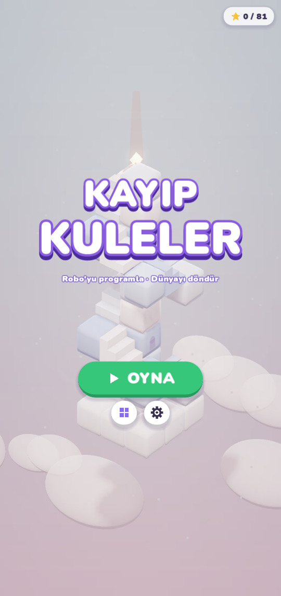
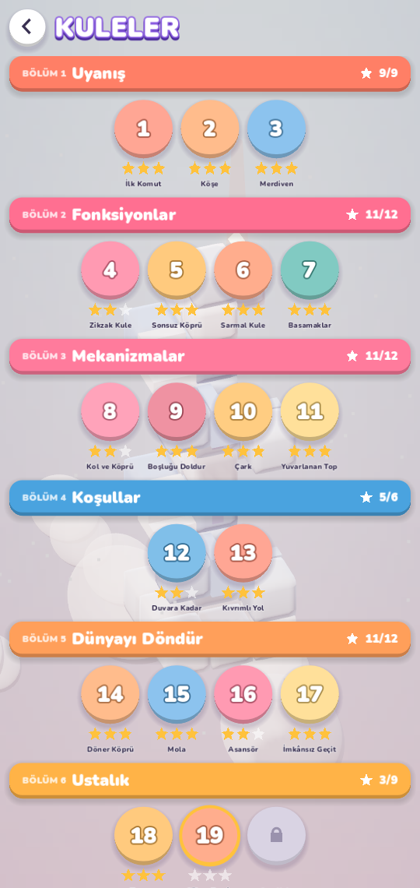

# Kayıp Kuleler — 3B Programlama Bulmacası (Android)

[](../../actions/workflows/android.yml)
[](../../actions/workflows/tests.yml)

Monument Valley ve Mekorama'dan esinlenen, izometrik pastel diorama görünümlü bir **programlama bulmacası**.
Küçük robot **Robo**'yu doğrudan yönetmezsin: ona komut bloklarından bir **program** yazarsın — İleri, Dön, Zıpla, Kullan,
fonksiyonlar, döngüler ve koşullar. Bu sırada Monument Valley'deki gibi **dünyayı sen döndürürsün**: döner köprüleri çevirir,
asansörleri kaldırır, kamerayı çevirip imkânsız geçitleri birleştirirsin. Hedef: her kulenin tepesindeki parlayan kristal.

<p align="center">
  
  
  
</p>
<p align="center">
  
  
</p>

| Sürüm | Klasör | Teknoloji |
|---|---|---|
| **Android uygulaması (ana sürüm, v2+)** | `godot-program/` | **Godot 4.8 beta 4**, Mobile (Vulkan) renderer, AgX ton eşleme, GDScript; modern mobil arayüz, ses ve müzik |
| Tarayıcı | `web/` | Three.js r170 + cannon-es (yerel olarak paketlendi, CDN yok) |
| Eski Android (v1.x, WebView) | `android/` | Kotlin + WebView; `web/` klasörünü paketler. Artık sürüm olarak yayınlanmaz |
| Godot (klasik mod) | `godot/` | Godot 4.3, GDScript — programlama öncesi "dokun-yürü" sürümü ve 15 klasik seviyesi |

Android ve tarayıcı sürümü **40 el yapımı seviyelik, 9 bölümlük programlama kampanyasını** içerir; her seviyenin
referans programı derleme sırasında gerçek yorumlayıcıda çalıştırılarak doğrulanır.

---

## Nasıl oynanır?

1. **Programı yaz.** Alttaki (yatay ekranda sağdaki) paletten bloklara dokun — imleç neredeyse oraya eklenir. Blokları
   **sürükleyip bırakarak** da ekleyebilir, yerini değiştirebilir, panelin dışına sürükleyerek silebilirsin.
   Bir bloğa dokununca çıkan küçük menüden taşı (◀ ▶), **koşul** ver ya da sil.
2. **Dünyayı hazırla.** Saplı döner platformları çevir, kaydırıcıları/asansörleri hareket ettir, kamerayı döndür.
3. **▶ Çalıştır.** Robo programı blok blok çalıştırır; çalışan blok parlar, koşulu tutmayan bloklar soluklaşır.
   **⏭ Tek adım** ile hata ayıklayabilir, **1× / 2× / 4×** ile hızlandırabilir, **■** ile başa sarabilirsin.
4. **Mola** bloğu programı duraklatır: Robo beklerken platformları çevir ya da bakış açısını değiştir, sonra **▶** ile devam et.

Robo kristale ulaştığı anda seviye biter. **Yıldızlar programın kısalığına göre** verilir: blok sayısı ≤ par ise 3 yıldız,
par + 3'e kadar 2 yıldız. Programlar ve ilerleme cihazda saklanır (`localStorage`).

### Komutlar

| Blok | Ne yapar | İlk seviye |
|---|---|---|
| ⬆ İleri | Baktığı yöne bir kare yürür; merdivenleri kendiliğinden çıkar/iner, göz yanılması geçitlerinden geçer | 1 |
| ↰ Sola dön / ↱ Sağa dön | Olduğu yerde 90° döner (Robo'nun kendi soluna/sağına göre; ayağının altındaki ok yönünü gösterir) | 2 |
| F1 / F2 | Fonksiyon çağrısı. Bir fonksiyon kendini çağırırsa **döngü** olur (kuyruk çağrısı, yığın büyümez) | 4 / 18 |
| ⤴ Zıpla | Önündeki bir kat yüksek bloğa çıkar ya da bir kat aşağı atlar | 7 |
| ✺ Kullan | Önündeki kolu çevirir, çarkı döndürür, kutuyu iter, topa vurur | 8 |
| ‖ Mola | Programı duraklatır; bu sırada dünyayı değiştirirsin | 15 |
| Koşullar | <span>✓ yeşil</span>: yalnızca **önü açıksa**, <span>✕ turuncu</span>: yalnızca **önü kapalıysa** çalışır | 12 |

Engele çarpan bir komut (ör. duvara doğru İleri) Robo'yu yerinde sarsar ve program devam eder. 300 komut sınırı sonsuz döngüleri durdurur.

### Bölümler ve seviyeler

| # | Bölüm | Seviye | Öğrettiği | Par (blok) |
|---|---|---|---|---|
| 1 | Uyanış | İlk Komut | sıralı komut | 4 |
| 2 | | Köşe | dönüşler | 7 |
| 3 | | Merdiven | merdivenler | 9 |
| 4 | Fonksiyonlar | Zikzak Kule | F1 ile tekrar eden desen | 8 |
| 5 | | Sonsuz Köprü | özyinelemeli döngü | 3 |
| 6 | | Sarmal Kule | döngüyle kuleye tırmanma | 5 |
| 7 | | Basamaklar | Zıpla | 9 |
| 8 | Mekanizmalar | Kol ve Köprü | Kullan, kol, beliren köprü | 8 |
| 9 | | Boşluğu Doldur | kutu itme, düşen kutu zemin olur | 6 |
| 10 | | Çark | Robo'nun döndürdüğü platform | 7 |
| 11 | | Yuvarlanan Top | top kola çarpar | 9 |
| 12 | Koşullar | Duvara Kadar | "önü açıksa / kapalıysa" ile sarmal | 4 |
| 13 | | Kıvrımlı Yol | genel yol izleyici algoritma | 6 |
| 14 | Dünyayı Döndür | Döner Köprü | oyuncunun çevirdiği platform | 3 |
| 15 | | Mola | Robo'yu taşıyan platformu molada çevirme | 6 |
| 16 | | Asansör | molada asansör kaldırma | 8 |
| 17 | | İmkânsız Geçit | kamera açısıyla birleşen yollar | 11 |
| 18 | Ustalık | Taşıyıcı | kutu + döner platform + kapı, iki mola | 12 |
| 19 | | Çöken Zemin | tek geçişlik taşlar, üç kol | 27 |
| 20 | | Son Kule | her şey bir arada | 24 |
| 21 | Yankılar | Terazi Kulesi | terazi platformları, iki kutuyla denge | 17 |
| 22 | | Ayna Kapı | ışınlayıcı halkalar (portallar) | 12 |
| 23 | | Kutu Işınlama | kutuyu ışınlayıcıyla uzak plakaya düşürme | 11 |
| 24 | | Yankı Labirenti | koşullu yol izleyici + çoklu kule portalları | 6 |
| 25 | | Yıldızlar Arası | döner köprü + ışınlayıcı + asansör + göz yanılması | 12 |
| 26 | | Paralel Çark | çark + ışınlayıcı + koşullu döngü | 8 |
| 27 | | Zamanlama Köprüsü | iki molada döner köprü ve kamera | 10 |
| 28 | Paradokslar | Gözlemci | hayalet bloklar: yalnızca kendi açısından bakınca katı | 7 |
| 29 | | Gölge Basamakları | hayalet basamağı kaybettirip kat kat inmek | 6 |
| 30 | | Düşen Gölge | kutuyu hayalet bloğa itip bakışla düşürmek | 13 |
| 31 | | Escher Avlusu | üç açı, üç gerçeklik: hayalet köprü + göz yanılması | 12 |
| 32 | | Penrose Merdiveni | sonsuz merdiven; çöken taşla döngüden çıkış | 4 |
| 33 | | Paradoks Kulesi | çark + göz yanılması + hayalet köprü, "önü açık oldukça yürü" | 15 |
| 34 | Yapay Zekâ Atölyesi | Merhaba, Nova | algoritma: sırası önemli adımlar | 8 |
| 35 | | Hata Ayıklama | hazır hatalı programı bulup düzeltme | 11 |
| 36 | | Desen İçinde Desen | desen tanıma: iç içe fonksiyonlar (F1 → F2) | 8 |
| 37 | | Sensör ve Karar | ajan: algıla → karar ver → davran | 4 |
| 38 | | Genelleme | her uzunlukta çalışan tek fonksiyon | 11 |
| 39 | | Ödül ve Ceza | pekiştirmeli öğrenme metaforu, programı kısaltma | 6 |
| 40 | | Akıllı Ajan | hazır ajana "Kullan" yeteneği kazandırma | 5 |

**Nova (yapay zekâ öğretmeni):** 9. bölümün kavram kartlarını Nova sunar. Bir program başarısız olduğunda Nova
çalıştırmayı analiz eder (`godot-program/scripts/nova.gd`): Robo'nun düştüğü ya da ilk takıldığı bloğu bulup seçer ve
sallar, yanlış yöne dönüşleri, sonsuz döngüleri, koşulsuz özyinelemeyi, kristale kalan mesafeyi ve hiç "Kullan"
denmeyen kutu/kol/çarkları açıklar. Par'ın üstündeki kazanışlarda ana programdaki tekrar eden deseni bulup
fonksiyona taşımayı önerir. Tamamen cihaz üzerinde, kurallarla çalışır; ağ gerektirmez.

Tüm referans çözümler `SOLUTIONS.md` dosyasındadır.

### Klavye kısayolları (tarayıcı)

| Tuş | Eylem |
|---|---|
| ↑ / ← / → / J / K / P / 1 / 2 | İleri / Sola / Sağa / Zıpla / Kullan / Mola / F1 / F2 bloğu ekle |
| Boşluk | Çalıştır / duraklat / devam |
| N | Tek adım |
| S veya Esc | Durdur, başa sar |
| Backspace / Delete | Seçili bloğu (ya da imleçten önceki bloğu) sil |
| Tab | Etkin satırı değiştir (Ana → F1 → F2) |
| Z | Geri al (program düzenlemesi ya da dünya işlemi) |
| Q / E | Kamerayı 90° çevir |
| R / H / M | Dünyayı başa al / İpucu / Seviyeler |

---

## 1. Android

### APK'yı indirip kurma
* **Sürümler:** [Releases](../../releases/latest) sayfasındaki `KayipKuleler-<sürüm>.apk`. Yeni sürüm yayınlamak için
  *Actions → Android APK (Godot — ana sürüm) → Run workflow* ve `release_tag` alanına `v2.1.0` gibi bir etiket.
* **Her push'tan sonra:** aynı iş akışının **Artifacts** bölümünde `KayipKuleler-apk`.
* Telefonda APK'yı açın ("bilinmeyen kaynaklardan yükleme" izni istenir). Android 7.0 (API 24) ve üzeri desteklenir.

> **Güncellemeler:** APK'lar depodaki kalıcı `android/keystore/kayipkuleler.jks` anahtarıyla imzalanır; uygulama kimliği
> `com.akin.kayipkuleler`, sürüm kodu 2000 + çalıştırma no. Bu sayede Godot ana sürümü (v2+) eski WebView sürümünün (v1.3+)
> **üstüne güncelleme olarak kurulur**. İlk açılışta eski sürümün ilerlemesi WebView'in localStorage dosyalarından
> otomatik okunup taşınır; olmazsa Ayarlar → *İlerleme yedeği* ile `KK1:` kodu yapıştırılabilir.
> (v1.3.0 öncesi APK'lar her derlemede değişen rastgele bir anahtarla imzalanmıştı; onlardan geçişte bir kerelik
> kaldırıp yeniden kurmak gerekir.) Anahtar herkese açık olduğundan Google Play için kendi gizli anahtarınızı verin.

### Uygulamanın özellikleri (Godot ana sürüm)
* Modern mobil arayüz: Nunito yazı tipi, kalın "basılabilir" butonlar, cam kartlar, kodla çizilmiş vektör ikonlar.
* Animasyonlar: buton basma yayları, ekran geçişleri, kart ve yıldız patlamaları, kademeli giriş efektleri, renk perdesi.
* Ekranlar: animasyonlu başlık, bölüm bantlı seviye haritası, oyun içi ekran, duraklatma, ayarlar, kazanma, tanıtım, yedek.
* Dikey **ve** yatay ekran: program paneli içeriği kadar yer kaplar (dikeyde altta, yatayda sağ altta); sırası yukarıdan
  aşağıya kod satırları → komut butonları (başparmak hizası) → aksiyon barı. Sahne her zaman boş alana ortalanır.
* Kamera: 3B alanda parmakla yatay sürükleyerek kule etrafında döner, bırakınca en yakın 90°'ye oturur (göz yanılması
  geçitleri bu açılara bağlıdır). Üst sağda yalnızca İpucu ve Kamerayı sıfırla; "Dünyayı başa al" duraklatma menüsünde.
* Görüntü: ferah soğuk gökyüzü gradyanı (#B8D4E8 → #EBF3F8), mimari taş/krem bloklar (#EAE4DC, #E2DACF, #D8CFC2,
  #C4D3DF; seviyenin paletinden yalnızca hafif ton), keskin ince pahlar (0,03) ve düz yüzler, yürünebilir üst yüzlerde
  karo plakası, mat malzeme (pürüzlülük 0,9). Doğrusal ton eşleme: renkler ekrana olduğu gibi gider (AgX/ACES açık pastel
  tonları soldurup beyazları tavanlıyordu). Sıcak güneş + soğuk ortam ışığıyla üst/sol/sağ yüzler üç ayrı tonda; temas
  gölgeleri bloklara gömülü (Mobile renderer SSAO desteklemez). Sahne genelinde parçacık ya da bulut yok; yalnızca hedef
  kristalden yukarı süzülen hafif ışıltılar. Amber robot, gölge lekesi; merdiven ve zıplama adımları eğimi izler.
* Kodla üretilen ses efektleri ve yumuşak ortam müziği (Ayarlar'dan açılıp kapanır).
* İlerleme ve her seviyedeki program `user://ilerleme.json` içinde saklanır.

### Yerel derleme
Gereken: JDK 17 ve Android SDK (platform 35). `ANDROID_HOME` ayarlı değilse `android/local.properties` içine `sdk.dir=/yol/android-sdk` yazın.
```bash
cd android
./gradlew assembleDebug      # app/build/outputs/apk/debug/app-debug.apk
./gradlew assembleRelease    # app/build/outputs/apk/release/app-release.apk
./gradlew installDebug       # bağlı cihaza / emülatöre kurar
```
`web/` tek doğruluk kaynağıdır: Gradle'daki `copyWebGame` görevi her derlemede `web/` klasörünü APK varlıklarına kopyalar —
oyunda yapılan her değişiklik bir sonraki derlemede uygulamaya girer, kopya dosya tutmaya gerek yoktur.

Uygulama simgesi (pastel izometrik küp, Robo ve kristal; uyarlanabilir + tek renkli) `python3 tools/make_icons.py` ile yeniden üretilir.

### GitHub Actions iş akışları
| Dosya | Ne zaman | Ne üretir |
|---|---|---|
| `.github/workflows/android.yml` | `main`'e push, PR, `v*` etiketi, elle | Debug + release APK (artifact); etikette GitHub Release |
| `.github/workflows/tests.yml` | `main`'e push, PR, elle | Seviye doğrulayıcı (20 program + 15 klasik), headless Chrome oyun testi, Godot mantık + sahne testleri |
| `.github/workflows/godot-android.yml` | `godot/` değişince, `v*` etiketi, elle | Godot ile dışa aktarılmış Android APK'ları (artifact / Release) |

Sürüm kodu `GITHUB_RUN_NUMBER`, sürüm adı etiketten (`v1.2.0` → `1.2.0`) ya da `1.0.<çalıştırma no>` olarak otomatik verilir.

---

## 2. Diğer sürümleri çalıştırma

### Tarayıcı sürümü (Three.js)
ES modülleri kullandığı için dosyayı çift tıklayarak değil, basit bir yerel sunucu ile açın:

```bash
cd web
python3 -m http.server 8765
# tarayıcıda: http://localhost:8765
```
İnternet bağlantısı gerekmez — three.js, RoundedBoxGeometry, son işleme eklentileri ve cannon-es `web/vendor/` içindedir.
Doğrudan bir seviyeyi açmak için: `http://localhost:8765/?level=9`

**Grafik kalitesi** (Seviyeler ekranındaki *Grafik* düğmesi; seçim saklanır):
*Düşük* = efekt yok · *Orta* = parıltı (bloom) + renk düzenleme + vinyet + 2x DPR ·
*Yüksek* (varsayılan) = Orta + 3x DPR'ye kadar süper örnekleme + 8x MSAA + 4096 px gölge haritası.

### Godot ana sürüm (`godot-program/`)
**Motor sürümü: Godot 4.8 beta 4** (`4.8.beta4.official`; ön sürümler [godot-builds](https://github.com/godotengine/godot-builds/releases) deposundan). Klasik `godot/` projesi Godot 4.3'te kalır.
Programlama oyununun yerel motor sürümü: aynı 40 seviye (`data/levels.json`, `tools/build.mjs` üretir), aynı kurallar
(`scripts/logic.gd` fizik motoru + `scripts/program.gd` yorumlayıcı — web sürümüyle birebir), aynı `KK1:` yedek kodu.
Mobile (Vulkan) renderer, AgX ton eşleme, parıltı, sis, yumuşak gölgeler; Vulkan olmayan cihazlarda OpenGL'e düşer.
* **Android APK:** bkz. bölüm 1. Arayüz kiti `scripts/ui_kit.gd`, sesler `scripts/audio.gd`.
* **Testler:**
  ```bash
  godot --headless --path godot-program --script res://tests/run_programs.gd   # yorumlayıcı: 40/40
  godot --headless --path godot-program -- --autotest                          # tam sahne: 40/40 + Nova analizi
  godot --path godot-program -- --shot=12:/tmp/seviye12.png:60                # ekran görüntüsü (0 başlık, -1 harita, -2 kazanma, -3 duraklatma; 4. parça: v2,intro,starter)
  ```
  `--autotest` ayrıca eski WebView ilerlemesinin taşınmasını sahte bir LevelDB günlüğüyle sınar.
  `--feeltest` animasyonları gerçek zamanlı sınar: açılış, 1x ve en hızlı modda koşu (esneme, dönüş zıplaması),
  zafer, kristalin geri gelmesi, silme animasyonu ve Durdur'da tween temizliği.
* **Game feel (prosedürel animasyonlar, `scripts/main.gd` → "Game feel" bölümü):** robot üç katmanlıdır — kök düğüm
  ızgara konumu/yönü, `vis` Tween'lerle sürülen katman (iniş ezilmesi, çarpma titremesi, 360° zafer dönüşü ve iki zıplama),
  `pose` her karede hesaplanan katman (boşta nefes, adımda esneme, dönüşte zıplama, anten ışığı nabzı). Bölüm açılışında
  bloklar alttan üste sırayla yaylanarak oturur (≤ 0,8 sn); robotun bastığı blok 0,05 birim esner; kristal toplanınca
  büyüyüp kaybolur ve parçacık patlaması çıkar. Komut ekleme (0,2 → 1, 0,15 sn) ve silme (0,1 sn) animasyonlu, çalışan
  komut 1,12 ölçek + altın çerçeveyle vurgulanır, yıldızlar 0,2 sn arayla esneyerek gelir. Tüm süreler hız çarpanına bölünür;
  tween'ler isimli tutulur ve yenisi başlamadan, seviye değişiminde, Durdur/Sıfırla'da `kill()` edilir.
* **Henüz yok:** blok sürükle-bırak (bloklar dokunarak eklenir; seçilen blok taşınır/silinir), iki parmakla yakınlaştırma.

### Godot sürümü (klasik)
* **Editörde:** Godot 4.3 (veya daha yeni 4.x) ile `godot/project.godot` dosyasını açıp F5'e basın.
* **Android APK (Godot):** Godot 4.3 + Android dışa aktarım şablonları + Android SDK ile
  ```bash
  GODOT=/yol/godot ANDROID_HOME=/yol/android-sdk JAVA_HOME=/yol/jdk17 \
    tools/godot-android-export.sh godot-build/KayipKuleler-godot.apk debug
  ```
  (Betik gerekirse bir debug anahtarı oluşturur ve Godot editör ayarlarını yazar.) Godot sürümü telefonda yatay açılır.
* **Web / Linux dışa aktarımı:** bkz. bölüm 5.

---

## 3. Mekanikler

| Mekanik | Açıklama | İlk seviye |
|---|---|---|
| Merdiven | İleri bloğu bir kat çıkar / iner | 3 |
| Kol | Robo önünde durup **Kullan** deyince açılır/kapanır, kalıcıdır | 8 |
| Basınç plakası | Üzerinde ağırlık (Robo, kutu, top) olduğu sürece sinyal verir | 18 |
| Beliren köprü / kapı | Sinyal doğruyken köprü katılaşır; kapılar sinyal ile açılır | 8, 18 |
| İtilebilir kutu | **Kullan** ile itilir; yerçekimiyle düşer, boşlukları doldurur, plakaları basılı tutar | 9 |
| Çark | Robo **Kullan** deyince bağlı platformu 90° döndürür (programla dünyayı değiştirme) | 10 |
| Yuvarlanan top | Vurulunca bir engele çarpana dek yuvarlanır, çarptığı kolu çevirir | 11 |
| Saplı döner platform | **Oyuncu** çevirir (çark sapına dokun / sürükle); üzerindeki her şeyi taşır | 14 |
| Kaydırıcı / asansör | Raylı platform; oyuncu oklarla ya da sürükleyerek hareket ettirir, yükünü taşır | 16 |
| Göz yanılması geçidi | Yalnızca belirli kamera açısından birleşen iki yol (halkalar dolunca geçit açıktır) | 17 |
| Çöken zemin | Robo üzerinden ayrılınca parçalanıp düşer | 19 |
| Terazi | Birbirine bağlı iki platform: ağır kefe aşağı iner, hafif olan yukarı çıkar | 21 |
| Işınlayıcı (portal) | Üzerine yürüyen Robo ya da itilen kutu aynı renkteki eşleşen halkadan anında çıkar | 22 |
| Hayalet blok | Yalnızca kendi renginin kamera açısından bakılırken katıdır; üstündeyken açı değişirse Robo/kutu düşer. Beliren blok bir varlığın içine doğamaz (o açıya dönülemez) | 28 |
| Hazır program (`starter`) | Hata ayıklama seviyelerinde hatalı bir programla başlanır; `build.mjs` kazanmadığını denetler | 35 |

**Mimari:** Bulmaca kuralları **deterministik bir ızgara fizik motorunda** (`web/js/engine.js`) çalışır; programlama katmanı
(`web/js/program.js`) komutları, koşulları, çağrı yığınını ve yorumlayıcıyı içerir ve render'dan bağımsızdır. Bu sayede
`tools/build.mjs` her seviyenin referans programını tarayıcı olmadan çalıştırıp doğrulayabilir. Gerçek rijit-cisim fiziği
(**cannon-es**) yalnızca görsel efektler içindir: çöken taşların parçaları ve zafer konfetisi.

---

## 4. Yeni seviye ekleme

`tools/program-levels.src.mjs` dosyasına bir nesne ekleyin. Koordinatlar `[x, y, z]`, **y yukarıdır**; Robo bir bloğun
*üstündeki* hücrede durur. Yönler: `0=+x 1=+z 2=-x 3=-z`.

```js
{
  chapter: 'Bölüm adı', name: 'Yeni Seviye', palette: 3, hint: 'İpucu metni',
  intro: { title: 'Yeni kavram', text: 'Seviye açılınca gösterilen kart (HTML olabilir)' },
  boxes:   [[0,0,0, 4,0,2]],                 // dolu kutular [x1,y1,z1, x2,y2,z2]
  stairs:  [{p:[3,1,0], d:0}],               // d: yükselme yönü
  levers:  [{id:'L1', p:[0,1,2]}],  plates: [{id:'P1', p:[4,1,2]}],
  bridges: [{cells:[[5,0,1]], on:'L1'}],     // '!P1' ve door:true ile kapı
  rotators:[{pivot:[x,z], blocks:[[..]], handle:[x,y,z]}],   // fixed:true -> yalnızca çarkla döner
  cranks:  [{p:[1,1,0], rot:0, dir:1}],      // Robo'nun çevirdiği çark
  sliders: [{blocks:[[..]], axis:[0,1,0], min:0, max:2, pos:0}],
  crates:  [[1,1,1]], balls: [[2,1,2]], crumbles: [[2,0,0]],
  links:   [{a:[2,1,0], b:[5,3,2], d:0, view:0}],   // göz yanılması (b = a + yön + k·görüş vektörü)
  view: 0, start: [0,1,0], startDir: 0, goal: [4,1,0],
  cmds: ['F','L','R','J','A','W','1','2'],   // palet
  conds: true,                               // koşullar açık mı
  slots: { main: 8, p1: 4, p2: 0 },          // satır kapasiteleri
  solution: { main: ['1'], p1: ['o:F','x:R','1'],          // 'o:' önü açıksa, 'x:' önü kapalıysa
              ops: [[{t:'rot', i:0, s:1}], [{t:'view', s:1}]] },  // ops[0] başta, ops[k] k. molada
}
```

Sonra derleyin:
```bash
cd tools
npm install        # yalnızca ilk sefer (three, cannon-es, playwright-core)
node build.mjs     # referans programları çalıştırır, kapasite/palet kurallarını ve
                   # mola işlemlerinin gerçekten gerekli olduğunu denetler, par'ı hesaplar;
                   # web/js/levels.js, godot/data/levels.json ve SOLUTIONS.md yazar
```
Klasik (Godot) seviyeler `tools/levels.src.mjs` içindedir ve BFS çözücüyle doğrulanır (`node show.mjs 9` bir çözümü durum durum gösterir).

---

## 5. Otomatik testler (yapılan doğrulamalar)

```bash
cd tools
node build.mjs                 # 20/20 referans program yorumlayıcıda kazanır + 15/15 klasik seviye çözülür
node test.mjs                  # Headless Chrome: sayfa yüklenir, konsol hatası = 0,
                               # 20 seviyenin programı gerçek arayüzden çalıştırılır (molalarda dünya işlemleriyle),
                               # Seviye 1 gerçek tıklamalarla (palet → Çalıştır) bitirilir,
                               # sürükle-bırak ile ekleme/silme denenir, yatay + dikey ekran görüntüleri alınır
G=/path/to/godot
$G --headless --path godot --script res://tests/run_solutions.gd   # GDScript motoru: 15/15
$G --headless --path godot -- --autotest                           # tam Godot sahnesi: 15/15
$G --headless --path godot --export-release "Web"   ../godot-build/web/index.html
$G --headless --path godot --export-release "Linux" ../godot-build/linux/KayipKuleler.x86_64
cd android && ./gradlew assembleDebug assembleRelease                # Android APK'ları
```
Godot testleri klasik seviyeleri kullanır (Godot sürümü programlama modunu içermez).

---

## 6. Klasör yapısı

```
android/        Gradle (Kotlin DSL) projesi: app/src/main/{AndroidManifest.xml, java/.../MainActivity.kt, res/}
web/            index.html, style.css, js/{engine,program,main,audio,fx,levels}.js, vendor/
                  engine.js  = ızgara fizik motoru, program.js = komutlar + yorumlayıcı
godot/          project.godot, scenes/main.tscn, scripts/{logic,main}.gd, data/levels.json,
                tests/run_solutions.gd, export_presets.cfg (Web, Linux, Android)
tools/          program-levels.src.mjs (kampanya), levels.src.mjs (klasik/Godot), build.mjs, show.mjs, test.mjs,
                make_icons.py (uygulama simgesi), godot-android-export.sh
.github/workflows/  android.yml, tests.yml, godot-android.yml
screenshots/    oynanış ekran görüntüleri
SOLUTIONS.md    tüm seviyelerin çözümleri
```

## 7. Bilinen sınırlamalar
* Release APK depodaki herkese açık kalıcı anahtarla imzalıdır (yan yükleme ve güncellemeler için yeterli; Play Store için kendi gizli anahtarınız gerekir).
* Android uygulaması sistem WebView'ini (WebGL 2) kullanır; çok eski / güncellenmemiş WebView'li cihazlarda performans düşük olabilir.
* Godot sürümü programlama modunu içermez: aynı fizik motorunun GDScript karşılığıyla klasik "dokun-yürü" modunu ve 15 klasik seviyeyi oynatır.
* Godot Android APK'sı ~70 MB'tır (motor dahil). Android emülatörünün yazılımsal GPU'sunda (SwiftShader, GLES 3.0)
  Godot'un sahne shader'ı uniform sınırını aştığı için 3B sahne çizilmiyor (arayüz çalışıyor); gerçek cihaz GPU'larında
  bu sınır daha yüksektir, ancak gerçek cihazda denenmedi.
* `godot-android.yml` ilk çalıştırmada Godot dışa aktarım şablonlarını (~1 GB) indirir; sonraki çalıştırmalarda önbellekten gelir.
* Testler yazılımsal GPU'lar (Chrome SwiftShader, Mesa llvmpipe, Android emülatörü) üzerinde yapıldı; fiziksel telefonda denenmedi.
