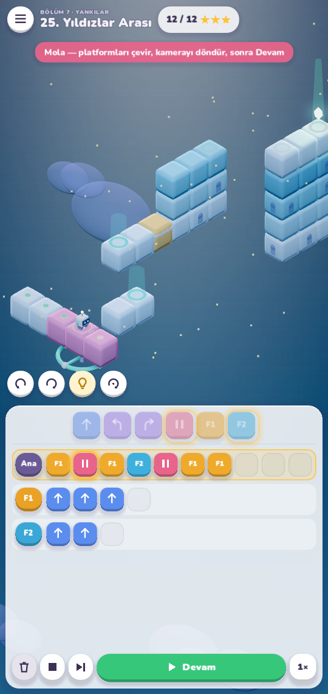
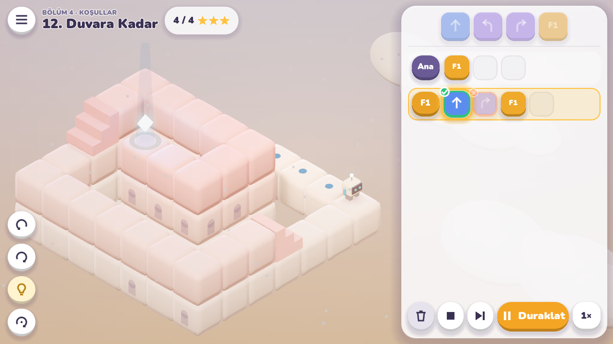
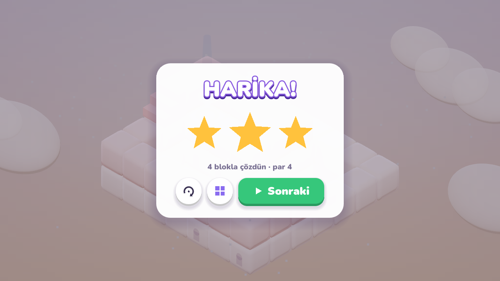

# Kayıp Kuleler — 3B Programlama Bulmacası (Android)

[](../../actions/workflows/android.yml)
[](../../actions/workflows/tests.yml)

Monument Valley ve Mekorama'dan esinlenen, izometrik pastel diorama görünümlü bir **programlama bulmacası**.
Küçük robot **Robo**'yu doğrudan yönetmezsin: ona komut bloklarından bir **program** yazarsın — İleri, Dön, Zıpla, Kullan,
fonksiyonlar, döngüler ve koşullar. Bu sırada Monument Valley'deki gibi **dünyayı sen döndürürsün**: döner köprüleri çevirir,
asansörleri kaldırır, kamerayı çevirip imkânsız geçitleri birleştirirsin. Hedef: her kulenin tepesindeki parlayan kristal.

<p align="center">
  
  
  
</p>
<p align="center">
  
  
</p>

| Sürüm | Klasör | Teknoloji |
|---|---|---|
| **Android uygulaması (ana sürüm, v3.5.0)** | `godot-program/` | **Godot 4.8 beta 4**, Mobile (Vulkan) renderer, doğrusal ton eşleme, GDScript; modern mobil arayüz, ses ve müzik |
| Tarayıcı | `web/` | Three.js r170 + cannon-es (yerel olarak paketlendi, CDN yok) |
| Eski Android (v1.x, WebView) | `android/` | Kotlin + WebView; `web/` klasörünü paketler. Artık sürüm olarak yayınlanmaz |
| Godot (klasik mod) | `godot/` | Godot 4.3, GDScript — programlama öncesi "dokun-yürü" sürümü ve 15 klasik seviyesi |

Android ve tarayıcı sürümü **100 seviyelik, 15 bölümlük programlama kampanyasını** içerir (40 el yapımı + 60 üretilmiş); her seviyenin
referans programı derleme sırasında gerçek yorumlayıcıda çalıştırılarak doğrulanır.

---

## Nasıl oynanır?

1. **Programı yaz.** Alttaki (yatay ekranda sağdaki) paletten bloklara dokun — imleç neredeyse oraya eklenir. Blokları
   **sürükleyip bırakarak** da ekleyebilir, yerini değiştirebilir, panelin dışına sürükleyerek silebilirsin.
   Bir bloğa dokununca çıkan küçük menüden taşı (◀ ▶), **koşul** ver ya da sil.
2. **Dünyayı hazırla.** Saplı döner platformları çevir, kaydırıcıları/asansörleri hareket ettir, kamerayı döndür.
3. **▶ Çalıştır.** Robo programı blok blok çalıştırır; çalışan blok parlar, koşulu tutmayan bloklar soluklaşır.
   **⏭ Tek adım** ile hata ayıklayabilir, **1× / 2× / 4×** ile hızlandırabilir, **■** ile başa sarabilirsin.
4. **Mola** bloğu programı duraklatır: Robo beklerken platformları çevir ya da bakış açısını değiştir, sonra **▶** ile devam et.

Robo kristale ulaştığı anda seviye biter. **Yıldızlar programın kısalığına göre** verilir: blok sayısı ≤ par ise 3 yıldız,
par + 3'e kadar 2 yıldız. Programlar ve ilerleme cihazda saklanır (`localStorage`).

### Komutlar

| Blok | Ne yapar | İlk seviye |
|---|---|---|
| ⬆ İleri | Baktığı yöne bir kare yürür; merdivenleri kendiliğinden çıkar/iner, göz yanılması geçitlerinden geçer | 1 |
| ↰ Sola dön / ↱ Sağa dön | Olduğu yerde 90° döner (Robo'nun kendi soluna/sağına göre; ayağının altındaki ok yönünü gösterir) | 2 |
| F1 / F2 | Fonksiyon çağrısı. Bir fonksiyon kendini çağırırsa **döngü** olur (kuyruk çağrısı, yığın büyümez) | 4 / 18 |
| ⤴ Zıpla | Önündeki bir kat yüksek bloğa çıkar ya da bir kat aşağı atlar | 7 |
| ✺ Kullan | Önündeki kolu çevirir, çarkı döndürür, kutuyu iter, topa vurur | 8 |
| ‖ Mola | Programı duraklatır; bu sırada dünyayı değiştirirsin | 15 |
| Koşullar | <span>✓ yeşil</span>: yalnızca **önü açıksa**, <span>✕ turuncu</span>: yalnızca **önü kapalıysa** çalışır | 12 |

Engele çarpan bir komut (ör. duvara doğru İleri) Robo'yu yerinde sarsar ve program devam eder. 300 komut sınırı sonsuz döngüleri durdurur.

### Bölümler ve seviyeler

| # | Bölüm | Seviye | Öğrettiği | Par (blok) |
|---|---|---|---|---|
| 1 | Uyanış | İlk Komut | sıralı komut | 4 |
| 2 | | Köşe | dönüşler | 7 |
| 3 | | Merdiven | merdivenler | 9 |
| 4 | Fonksiyonlar | Zikzak Kule | F1 ile tekrar eden desen | 8 |
| 5 | | Sonsuz Köprü | özyinelemeli döngü | 3 |
| 6 | | Sarmal Kule | döngüyle kuleye tırmanma | 5 |
| 7 | | Basamaklar | Zıpla | 9 |
| 8 | Mekanizmalar | Kol ve Köprü | Kullan, kol, beliren köprü | 8 |
| 9 | | Boşluğu Doldur | kutu itme, düşen kutu zemin olur | 6 |
| 10 | | Çark | Robo'nun döndürdüğü platform | 7 |
| 11 | | Yuvarlanan Top | top kola çarpar | 9 |
| 12 | Koşullar | Duvara Kadar | "önü açıksa / kapalıysa" ile sarmal | 4 |
| 13 | | Kıvrımlı Yol | genel yol izleyici algoritma | 6 |
| 14 | Dünyayı Döndür | Döner Köprü | oyuncunun çevirdiği platform | 3 |
| 15 | | Mola | Robo'yu taşıyan platformu molada çevirme | 6 |
| 16 | | Asansör | molada asansör kaldırma | 8 |
| 17 | | İmkânsız Geçit | kamera açısıyla birleşen yollar | 11 |
| 18 | Ustalık | Taşıyıcı | kutu + döner platform + kapı, iki mola | 12 |
| 19 | | Çöken Zemin | tek geçişlik taşlar, üç kol | 27 |
| 20 | | Son Kule | her şey bir arada | 24 |
| 21 | Yankılar | Terazi Kulesi | terazi platformları, iki kutuyla denge | 17 |
| 22 | | Ayna Kapı | ışınlayıcı halkalar (portallar) | 12 |
| 23 | | Kutu Işınlama | kutuyu ışınlayıcıyla uzak plakaya düşürme | 11 |
| 24 | | Yankı Labirenti | koşullu yol izleyici + çoklu kule portalları | 6 |
| 25 | | Yıldızlar Arası | döner köprü + ışınlayıcı + asansör + göz yanılması | 12 |
| 26 | | Paralel Çark | çark + ışınlayıcı + koşullu döngü | 8 |
| 27 | | Zamanlama Köprüsü | iki molada döner köprü ve kamera | 10 |
| 28 | Paradokslar | Gözlemci | hayalet bloklar: yalnızca kendi açısından bakınca katı | 7 |
| 29 | | Gölge Basamakları | hayalet basamağı kaybettirip kat kat inmek | 6 |
| 30 | | Düşen Gölge | kutuyu hayalet bloğa itip bakışla düşürmek | 13 |
| 31 | | Escher Avlusu | üç açı, üç gerçeklik: hayalet köprü + göz yanılması | 12 |
| 32 | | Penrose Merdiveni | sonsuz merdiven; çöken taşla döngüden çıkış | 4 |
| 33 | | Paradoks Kulesi | çark + göz yanılması + hayalet köprü, "önü açık oldukça yürü" | 15 |
| 34 | Yapay Zekâ Atölyesi | Merhaba, Nova | algoritma: sırası önemli adımlar | 8 |
| 35 | | Hata Ayıklama | hazır hatalı programı bulup düzeltme | 11 |
| 36 | | Desen İçinde Desen | desen tanıma: iç içe fonksiyonlar (F1 → F2) | 8 |
| 37 | | Sensör ve Karar | ajan: algıla → karar ver → davran | 4 |
| 38 | | Genelleme | her uzunlukta çalışan tek fonksiyon | 11 |
| 39 | | Ödül ve Ceza | pekiştirmeli öğrenme metaforu, programı kısaltma | 6 |
| 40 | | Akıllı Ajan | hazır ajana "Kullan" yeteneği kazandırma | 5 |
| 41–50 | Zamanlama | 10 seviye | döner platformlara binme, asansörler, molada dünyayı çevirme | |
| 51–60 | Paralel Yollar | 10 seviye | ışınlayıcı, göz yanılması geçidi, hayalet blok; doğru açı doğru anda | |
| 61–70 | Kuleyi Kodlamak | 10 seviye | kol, kutu ve çark zincirleri; uzun çözümler F1/F2'ye sıkıştırılmalı | |
| 71–80 | Hata Avcısı | 10 seviye | her seviyede tek hatalı hazır program (Nova) | |
| 81–90 | Optimizasyon | 10 seviye | özyinelemeli desenler, "önü açık oldukça yürü", duvar izleyici ve ajan labirentleri | |
| 91–100 | Büyük Final | 10 seviye | tüm mekanikler bir arada | |

**Üretilmiş seviyeler (41–100, `tools/gen-extra.mjs`):** her seviye önce çözüm planından kurulur. Bir "Builder"
Robo'yu boş dünyada adım adım yürütür; bastığı yere blok, merdiven, kol + köprü, kutu + boşluk, çark + döner köprü,
binilen döner platform, asansör, ışınlayıcı, göz yanılması geçidi ve hayalet köprü yerleştirir, komutları ve molalardaki
dünya işlemlerini kaydeder. Düz komut listesi tekrar eden desenlere göre F1/F2'ye sıkıştırılır ve kapasiteler buna göre
dar tutulur (fonksiyonlar zorunludur). Hata Avcısı seviyelerinde doğru çözüme tek bir hata (ters dönüş, yer değiştirmiş
iki blok, yanlış komut) sokulur. Üretim tohumludur (her derlemede aynı seviyeler) ve her aday gerçek yorumlayıcıda
çalıştırılır; kazanmayan, dünya işlemi olmadan da kazanılan ya da hatalı hali kazanan adaylar atılır.

**Nova (yapay zekâ öğretmeni):** 9. bölümün kavram kartlarını Nova sunar. Bir program başarısız olduğunda Nova
çalıştırmayı analiz eder (`godot-program/scripts/nova.gd`): Robo'nun düştüğü ya da ilk takıldığı bloğu bulup seçer ve
sallar, yanlış yöne dönüşleri, sonsuz döngüleri, koşulsuz özyinelemeyi, kristale kalan mesafeyi ve hiç "Kullan"
denmeyen kutu/kol/çarkları açıklar. Par'ın üstündeki kazanışlarda ana programdaki tekrar eden deseni bulup
fonksiyona taşımayı önerir. Tamamen cihaz üzerinde, kurallarla çalışır; ağ gerektirmez.

Tüm referans çözümler `SOLUTIONS.md` dosyasındadır.

### Klavye kısayolları (tarayıcı)

| Tuş | Eylem |
|---|---|
| ↑ / ← / → / J / K / P / 1 / 2 | İleri / Sola / Sağa / Zıpla / Kullan / Mola / F1 / F2 bloğu ekle |
| Boşluk | Çalıştır / duraklat / devam |
| N | Tek adım |
| S veya Esc | Durdur, başa sar |
| Backspace / Delete | Seçili bloğu (ya da imleçten önceki bloğu) sil |
| Tab | Etkin satırı değiştir (Ana → F1 → F2) |
| Z | Geri al (program düzenlemesi ya da dünya işlemi) |
| Q / E | Kamerayı 90° çevir |
| R / H / M | Dünyayı başa al / İpucu / Seviyeler |

---

## 1. Android

### APK'yı indirip kurma
* **Sürümler:** [Releases](../../releases/latest) sayfasındaki `KayipKuleler-<sürüm>.apk`. Sürüm adı
  `godot-program/project.godot` içindeki `config/version` değeridir. Bu dosya `main`'e birleşince Android iş akışı
  `v2.4.2` gibi bir etiket ve yayındaki APK'yı oluşturur. Elle yayın için *Actions → Android APK (Godot — ana sürüm) → Run workflow*
  ve `release_tag` alanına `v2.4.2` gibi bir etiket.
* **Her push'tan sonra:** aynı iş akışının **Artifacts** bölümünde `KayipKuleler-apk`.
* Telefonda APK'yı açın ("bilinmeyen kaynaklardan yükleme" izni istenir). Android 7.0 (API 24) ve üzeri desteklenir.

> **Güncellemeler:** APK'lar depodaki kalıcı `android/keystore/kayipkuleler.jks` anahtarıyla imzalanır; uygulama kimliği
> `com.akin.kayipkuleler`, sürüm kodu 2000 + çalıştırma no. Bu sayede Godot ana sürümü (v2+) eski WebView sürümünün (v1.3+)
> **üstüne güncelleme olarak kurulur**. İlk açılışta eski sürümün ilerlemesi WebView'in localStorage dosyalarından
> otomatik okunup taşınır; olmazsa Ayarlar → *İlerleme yedeği* ile `KK1:` kodu yapıştırılabilir.
> (v1.3.0 öncesi APK'lar her derlemede değişen rastgele bir anahtarla imzalanmıştı; onlardan geçişte bir kerelik
> kaldırıp yeniden kurmak gerekir.) Anahtar herkese açık olduğundan Google Play için kendi gizli anahtarınızı verin.

### Uygulamanın özellikleri (Godot ana sürüm)
* Modern mobil arayüz: Nunito yazı tipi, kalın "basılabilir" butonlar, cam kartlar, kodla çizilmiş vektör ikonlar.
* Animasyonlar: buton basma yayları, ekran geçişleri, kart ve yıldız patlamaları, kademeli giriş efektleri, renk perdesi.
* Ekranlar: animasyonlu başlık, bölüm bantlı seviye haritası, oyun içi ekran, duraklatma, ayarlar, kazanma, tanıtım, yedek.
* Dikey **ve** yatay ekran: program paneli içeriği kadar yer kaplar (dikeyde altta, yatayda sağ altta) ve ekran
  çentiği / güvenli alanı kadar içeriden durur. Sırası yukarıdan aşağıya fonksiyon sekmeleri (Ana, F1, F2) → kod
  satırları → komut butonları → menü, ipucu, kamera ve tema (başparmak hizası) → aksiyon barı. Başlık üstte, çentiğin
  altında kalır. Sahne her zaman boş alana ortalanır.
* Kamera: parmakla veya fareyle kule etrafında 360°'nin herhangi bir açısına döner, bırakınca ataletle süzülüp durur.
  Tekerlek, izleme dörtgeni ve iki parmak sıkıştırma yakınlaştırır. Göz yanılması ve hayalet bloklar en yakın yasal 90°
  bakışta çözülür; Q/E hâlâ bir dilim çevirir. Kamerayı sıfırla varsayılan kadraja döner.
* Görüntü: ferah soğuk gökyüzü gradyanı (#B8D4E8 → #EBF3F8), mimari taş/krem bloklar (#EAE4DC, #E2DACF, #D8CFC2,
  #C4D3DF; seviyenin paletinden yalnızca hafif ton), keskin ince pahlar (0,03) ve düz yüzler, yürünebilir üst yüzlerde
  karo plakası, mat malzeme (pürüzlülük 0,9). Doğrusal ton eşleme: renkler ekrana olduğu gibi gider (AgX/ACES açık pastel
  tonları soldurup beyazları tavanlıyordu). Sıcak güneş + soğuk ortam ışığıyla üst/sol/sağ yüzler üç ayrı tonda; temas
  gölgeleri bloklara gömülü (Mobile renderer SSAO desteklemez). Sahne genelinde parçacık ya da bulut yok; yalnızca hedef
  kristalden yukarı süzülen hafif ışıltılar. Amber robot, gölge lekesi; merdiven ve zıplama adımları eğimi izler.
* Kodla üretilen ses efektleri ve yumuşak ortam müziği (Ayarlar'dan açılıp kapanır).
* İlerleme ve her seviyedeki program `user://ilerleme.json` içinde saklanır.

### Yerel derleme
Gereken: JDK 17 ve Android SDK (platform 35). `ANDROID_HOME` ayarlı değilse `android/local.properties` içine `sdk.dir=/yol/android-sdk` yazın.
```bash
cd android
./gradlew assembleDebug      # app/build/outputs/apk/debug/app-debug.apk
./gradlew assembleRelease    # app/build/outputs/apk/release/app-release.apk
./gradlew installDebug       # bağlı cihaza / emülatöre kurar
```
`web/` tek doğruluk kaynağıdır: Gradle'daki `copyWebGame` görevi her derlemede `web/` klasörünü APK varlıklarına kopyalar —
oyunda yapılan her değişiklik bir sonraki derlemede uygulamaya girer, kopya dosya tutmaya gerek yoktur.

Uygulama simgesi `art/icon-4096.png` kaynağından `python3 tools/make_icons.py` ile üretilir (Godot proje simgesi, Android başlatıcı ve uyarlanabilir katmanlar, tarayıcı favicon).

### GitHub Actions iş akışları
| Dosya | Ne zaman | Ne üretir |
|---|---|---|
| `.github/workflows/android.yml` | `main`'e push, PR, `v*` etiketi, elle | Debug + release APK (artifact); etikette GitHub Release |
| `.github/workflows/tests.yml` | `main`'e push, PR, elle | Seviye doğrulayıcı (20 program + 15 klasik), headless Chrome oyun testi, Godot mantık + sahne testleri |
| `.github/workflows/godot-android.yml` | `godot/` değişince, `v*` etiketi, elle | Godot ile dışa aktarılmış Android APK'ları (artifact / Release) |

Sürüm kodu `GITHUB_RUN_NUMBER`, sürüm adı etiketten (`v1.2.0` → `1.2.0`) ya da `1.0.<çalıştırma no>` olarak otomatik verilir.

---

## 2. Diğer sürümleri çalıştırma

### Tarayıcı sürümü (Three.js)
ES modülleri kullandığı için dosyayı çift tıklayarak değil, basit bir yerel sunucu ile açın:

```bash
cd web
python3 -m http.server 8765
# tarayıcıda: http://localhost:8765
```
İnternet bağlantısı gerekmez — three.js, RoundedBoxGeometry, son işleme eklentileri ve cannon-es `web/vendor/` içindedir.
Doğrudan bir seviyeyi açmak için: `http://localhost:8765/?level=9`

**Grafik kalitesi** (Seviyeler ekranındaki *Grafik* düğmesi; seçim saklanır):
*Düşük* = efekt yok · *Orta* = parıltı (bloom) + renk düzenleme + vinyet + 2x DPR ·
*Yüksek* (varsayılan) = Orta + 3x DPR'ye kadar süper örnekleme + 8x MSAA + 4096 px gölge haritası.

### Godot ana sürüm (`godot-program/`)
**Motor sürümü: Godot 4.8 beta 4** (`4.8.beta4.official`; ön sürümler [godot-builds](https://github.com/godotengine/godot-builds/releases) deposundan). Klasik `godot/` projesi Godot 4.3'te kalır.
Programlama oyununun yerel motor sürümü: aynı 100 seviye (`data/levels.json`, `tools/build.mjs` üretir), aynı kurallar
(`scripts/logic.gd` fizik motoru + `scripts/program.gd` yorumlayıcı — web sürümüyle birebir), aynı `KK1:` yedek kodu.
Mobile (Vulkan) renderer, AgX ton eşleme, parıltı, sis, yumuşak gölgeler; Vulkan olmayan cihazlarda OpenGL'e düşer.
* **Android APK:** bkz. bölüm 1. Arayüz kiti `scripts/ui_kit.gd`, sesler `scripts/audio.gd`.
* **Testler:**
  ```bash
  godot --headless --path godot-program --script res://tests/run_programs.gd   # yorumlayıcı: 100/100
  godot --headless --path godot-program -- --autotest                          # tam sahne: 100/100 + Nova analizi
  godot --headless --path godot-program -- --layouttest                       # telefon genişliği, yatay ekran, çentik
  godot --path godot-program -- --shot=12:/tmp/seviye12.png:60                # ekran görüntüsü (0 başlık, -1 harita, -2 kazanma, -3 duraklatma; 4. parça: v2,intro,starter,cutout)
  ```
  `--autotest` ayrıca eski WebView ilerlemesinin taşınmasını sahte bir LevelDB günlüğüyle sınar.
  `--feeltest` animasyonları gerçek zamanlı sınar: açılış, 1x ve en hızlı modda koşu (esneme, dönüş zıplaması),
  zafer, kristalin geri gelmesi, silme animasyonu ve Durdur'da tween temizliği.
* **Devre kampanyası (`data/levels_100.json`, Godot ana sürüm):** 10 donanım fazı × 10 seviye; N. seviye N. parçayı
  kazandırır. `tools/level_database_builder.gd` seviyeleri oyunun kendi tur tabanlı motoruyla üretir ve doğrular
  (`--check`: `levels_100: 100/100 solvable`), her seviyeye `par_commands` ve `hint_solution` yazar. Mekanik eğrisi:
  Faz 1–2 SMD + hareket/yükseklik/F1, Faz 3–4 diyot (ters ve sahte yollar), Faz 5–6 kondansatör (2 kat fırlatan dahil),
  Faz 7 röle OR, Faz 8 röle AND + klon, Faz 9 direnç (1–2 tur, sonra AND senkronu), Faz 10 hepsi. F2 yok.
  `par_commands` yuva sınırındaki en kısa programdır (`--check` 100/100 çözülür ve par tutarlı değilse çıkar).
  Bileşen şeması: `comps: [{p, component_type, direction, circuit_id | target_relay_id, logic_mode: OR|AND,
  delay_turns, boost_height}]`, köprü `on: "C:<circuit_id>"`, `enable_clone`. Yürütme tur tabanlıdır
  (`Program.tick`): her turda önce klon F1'den, sonra Robo kendi satırından bir komut çalıştırır; direnç turları
  sayaçla bekletir; AND devresi bütün röleleri aynı turda basılı görünce kilitlenir. İpucu ampulü kayıtlı çözümden
  sıradaki tek adımı gösterir. Web sürümü eski 100 seviyelik kampanyada kalır (`tools/build.mjs`).
* **Geliştirici menüsü (Ayarlar):** Seviyeye Atla (1–100), Finali Test Et (100/100); Bilgisayarım'da Montajı Test Et.
* **Büyük final (`scripts/pc/final_boot_sequence.gd`):** 100. parça takılınca ~30 sn: Robo güç tuşuna zıplar, fanlar
  0 devirden hızlanır, enerji dalgası fazları dolaşır, monitörde SubViewport ile canlı BIOS/POST ekranı, masaüstü ve
  "SİSTEM ÇEVRİMİÇİ — TEBRİKLER"; sonunda Atölyede İncele / Ana Menü.
* **Ses ve haptik (`scripts/audio/audio_haptics_manager.gd`, autoload `AudioHaptics`):** bütün sesler açılışta bir kez
  16 bit PCM olarak üretilip önbelleğe alınır (pentatonik adımlar, kondansatör sweep, hata, röle, tuş "thock", montaj
  snap + cızırtı, güç tuşu, fan döngüsü, POST beep, Cmaj7 açılış akoru); `res://assets/audio/<ad>.wav|.ogg` varsa o
  kullanılır. Titreşim: 12 ms komut, 30+30 ms hata, 45 ms montaj, 60 ms güç; Ayarlar'da Ses ve Titreşim anahtarları.
* **Blender varlıkları (`tools/blender_asset_generator.py`):** `blender --background --python tools/blender_asset_generator.py`
  (Blender 5.x; bu ortamda PyPI `bpy` + `blender` sarmalayıcısı) robotu, 5 devre elemanını, köprüyü ve 100 PC parçasını
  `.glb` olarak `godot-program/assets/models/` altına üretir (~9 sn). Her model: ince pah (Bevel 2–3 segment, 0,015–0,025;
  ince parçalarda kısılır), açıyla yumuşatma + WeightedNormal, üçgenleştirme (tanjantlar için), Smart UV, Principled BSDF
  (Metallic/Roughness/Emission/Transmission), uygulanmış dönüş/ölçek, orijin taban merkezinde. PC parçaları
  `tools/pc_parts.py`'deki montaj kutularına birebir kurulur. Godot'nun adla bulduğu malzeme yuvaları: `RobotLED`
  (tema/mod rengi), `Pins` (basışta parlama), `ChargeRing`, `Band1`–`Band4` (direnç gecikmesi), `MonitorScreen`
  (finaldeki BIOS SubViewport dokusu), `RelayCover`, `DiodeArrow`, `BridgeLED`. Üçgen bütçeleri: robot ≤ 10 000,
  bileşen ≤ 8 000, parça ≤ 6 000 (büyük parçalar ≤ 14 000); rapor `tools/blender_assets_report.json`. Diyot modeli -Z'ye
  bakar (oyun yön 0 = +X, fabrika -90° ofset uygular), robotun önü +Z. Grafik "Düşük"te prosedürel modeller kullanılır.
  Test: `--script res://tests/run_assets.gd`.
* **İskeletli robot:** `robot.glb` katı derili bir iskelet (root, body, head, antenna, kollar, 6 palet tekerleği) ve 7
  animasyon taşır: `idle`, `walk` (tekerlekler döner), `turn`, `fall`, `victory`, `wave`, `look`. Oyunda
  `AnimationPlayer` komuta göre klip seçer (F/J yürü, L/R dön, düşüşte fall, kazanınca victory, boşta ara sıra look);
  finalde Robo güç tuşuna giderken el sallar, sonunda zafer dansı yapar. Başlık ekranında dioramadaki Robo selam verir.
* **İkinci dalga Blender varlıkları (`tools/blender_scene_generator.py`, `tools/blender_2d_generator.py`):**
  `blender --background --python tools/blender_scene_generator.py -- [--only puzzle,pcb,workshop,title,phases,themes,icon,cmds,store]`
  (render'lar Cycles CPU; birleştirme `tools/compose_2d.py`, sistem `python3` + Pillow). Üretilenler:
  * `assets/models/puzzle/`: PCB basamaklı merdiven, hedef kuantum işlemci (`CrystalCore` → tema kristal malzemesi),
    CPU paketi kasa, sigorta şalteri kol, soğutuculu çark, fan çerçeveli döner tutamaç, raylı kayar blok, fiber optik
    ışınlayıcı (`PortalGlow`), membran basınç plakası (`PlateLED` basınca yanar), yanık çöken blok, hayalet blok ışık
    çerçevesi (`PhantomFrame` → bakış rengi). Her biri ≤ 6 000 üçgen.
  * `assets/textures/pbr/pcb_detail/{albedo,normal,mask}.png`: 4×4 birimlik döşenebilir PCB kartı geometrisi tepeden
    pişirilir (renk, yükseklik → normal, maske R=yol G=metal B=serigrafi); `pcb.gdshader` bunu kullanır, adım darbesi
    yollar boyunca yayılmaya devam eder.
  * `assets/models/scenes/workshop.glb` (montaj atölyesi: masa, ESD altlık, delikli pano + aletler, raflar ve
    çekmeceler, havya istasyonu, alet çantası, büyüteçli lamba, softbox'lar; PC'nin alanı boş bırakılır) ve
    `title_diorama.glb` (yüzen devre adasında kayıp kule, `RobotSpot` boş düğümü).
  * `assets/models/themes/theme_01..15.glb`: 15 bölüm temasının dekor setleri (kulenin iki yanında; ≤ 8 000 üçgen).
  * `assets/ui/phase_01..10.png` (seviye haritasındaki faz adası ikonları) ve `assets/ui/cmd_<C>.png` (F L R J A W 1 2 C
    komut ikonları; dosya yoksa vektör çizim).
  * `art/icon-4096.png` → `tools/make_icons.py` ile tüm başlatıcı simgeleri; `store/feature_graphic.png` (1024×500)
    ve `store/screenshots/`.
  Grafik ayarı "Düşük"te bu modellerin yerine prosedürel sürümler kullanılır. Rapor: `tools/blender_scene_report.json`.
* **Arayüz: Blueprint v2 (Aviyonik / PCB CAD) tasarım sistemi (`scripts/ui/blueprint.gd`, `shaders/blueprint_grid.gdshader`):**
  renk tokenları (`BG_NAVY_DEEP #071224`, `SURFACE_PANEL #0B192EE6`, `SURFACE_MODAL #091529F0`, `SCRIM_DARK #040A14CC`,
  `BORDER_STEEL #2B4C7E`, `ACCENT_CYAN #00E5FF`, `ACCENT_AMBER #F59E0B`, `DANGER_CORAL #F45B69`, `TEXT_PRIMARY`,
  `TEXT_MUTED`), 45° pahlı `StyleBoxFlat` (`corner_detail = 1`, yarıçap 6/10/14, kontur yok), merkezi Theme ve Type
  Variations (`PrimaryButton`, `AmberButton`, `DangerButton`, `ChamferPanel`, `ModalPanel`), milimetrik ızgara + vinyet
  arka plan (başlıkta 3D vitrin penceresiyle). Yazı tipi Chakra Petch (OFL, `fonts/`). `UIKit` eski renk parametrelerini
  varyantlara çevirir (yeşil → Primary, mercan → Danger, amber → Amber, diğerleri wireframe). Ekranlar: HUD
  (`FAZ 02 // PSU` + seviye adı, adım rozeti), tek satırlı kodlama paneli (menü · ipucu · sıfırla · geri al/adım ·
  ▶ ÇALIŞTIR · hız; yön komutları cyan, F1/F2 amber), KULELER (yatay faz sekmeleri, telemetri şeridi + amber ilerleme,
  3 sütunlu pahlı kartlar), Duraklatma (`SYS // PAUSED`), Ayarlar (`SYS // CONFIG`: ses/müzik kareleri, 3 parçalı
  grafik seçici, oyun içinden taşınan tema seçici, gerçek titreşim anahtarı, erişilebilirlik; geliştirici paneli yalnızca
  debug derlemede), Bilgisayarım (`SİSTEM MONTAJI // %X`, faz kartları, PC özelleştirme). Kaydırılabilir alanların hepsi
  `DragScroller` ile parmakla kaydırılır (butonlar dokunuşu yutsa da; sürükleme sonrası bırakma butona gitmez).
* **Yeni oynanış:** Günlük bulmaca (`scripts/levels/daily_generator.gd`: tarihten tohumlanır, kampanya kurucusuyla
  üretilir, motor içinde doğrulanır; seri sayacı), Kule Atölyesi (3D editör: blok/çöken/sigorta/sil/başla/hedef, kat
  seçimi, satır kapasiteleri; TEST ET ile çözülünce doğrulanır, `KKL1:` paylaşım koduyla kaydedilir/oynanır), sayaçlı
  tekrar (`F*3`, seçili blok → ×2/×3/×4), "Röle açıksa" koşulu, sigorta bileşeni (iki geçişte yanar), meydan okumalar
  (PAR ALTI · HIZLI · İPUCUSUZ), 15 başarım, yıldızla açılan Robo aksesuarları, faz başlarında Nova hikâye kartları,
  çözümü tekrar izleme ve paylaşma (metin panoya, ekran görüntüsü `user://paylasim/`), faz başına prosedürel müzik
  (adım sesleri akorla uyumlu), erişilebilirlik (renk körü paleti, büyük yazı, komutları sesli okuma), geri al yığını,
  boş alana çift dokunuşla kamera sıfırlama. Test: `--script res://tests/run_features.gd`.
* **Mantık kapıları ve zamanlayıcı:** röle devreleri `OR` (kilitlenir), `XOR` (anlık; tam bir röle basılıyken açık) ve
  köprüde `!C:x` (NOT) sinyali; `T:n` zamanlayıcı köprüsü n turda bir açılıp kapanır (555 osilatörü; durum `tick`
  sayacı). Atölyede yeni araçlar: RÖLE, KÖPRÜ, KÖPRÜ ¬, ZAMANLI ve DEVRE: OR/XOR anahtarı (bir röle hattı birden çok
  köprüyü sürer = sinyal kablosu).
* **Hata Avı (`scripts/levels/bug_hunt.gd`):** bitirilmiş bir kampanya seviyesinin çözümüne 1-2 hata enjekte edilir
  (komut değiştirme, eksik/fazla komut, yer değiştirme; hatalı programın gerçekten kaybettiği simülasyonla doğrulanır).
  Oyuncu en az düzenlemeyle onarır; puan satır bazlı Levenshtein mesafesi (≤ hata → 3★). Atölye → HATA AVI.
* **Robo koleksiyonu:** 14 aksesuar (anten, baret, papyon, kulaklık, gözlük, taç, silindir, hale, atkı, büyücü şapkası,
  dönen pervane, vizör, kedi kulağı, çiçek) ve 12 gövde boyası (krom, altın, bakır, karbon, ışıyan neon, blueprint…);
  yıldızla ya da başarımla açılır (Başarımlar → KOLEKSİYON). 18 başarım.
* **Fotoğraf modu (Duraklatma → FOTOĞRAF MODU):** arayüz gizlenir; sürükleyerek serbest yörünge (yatay + dikey açı),
  tekerlek/çimdik/± ile 0.4×–4× yakınlaşma, ROBO odağı, filtreler (normal, sepya, noir, neon, blueprint ızgaralı —
  `post_grade.gdshader` `filter`), alan derinliği anahtarı; ÇEK → `user://photos/` (+ mümkünse Resimler/KayipKuleler).
* **2K PBR + HDRI + LightmapGI (ADIM 7):**
  `python3 tools/build_2k_pbr_library.py` gerçek CC0 2K setleri indirir (ambientCG Metal012 / Metal057A / Plastic012A /
  Porcelain001, Poly Haven dark_wood) ve 2K stüdyo HDRI'larını (Poly Haven studio_small_08, photo_studio_loft_hall);
  ağ yoksa prosedürel 2K üretir. `pcb_circuit_2k` ve `gold_contacts_2k` prosedüreldir. `tools/configure_pbr_imports.py`
  2K dokuları VRAM sıkıştırmalı (ETC2/ASTC) + mipmap yapar, normal haritalarını RG sıkıştırır, statik modellere
  `light_baking=Static` verir. `res://tools/make_pbr_materials.gd` → `assets/materials/pbr/*.tres`
  (`PBRMaterialBank`); `AssetLoader` glTF malzeme adlarını (Aluminum, Copper, Epoxy, PCB, DeskWood…) bu bankaya bağlar.
  Blender `finalize()` her statik modele çakışmasız `UVMap2` ekler (LightmapGI UV2). Ortam: HDRI ortam + yansıma ışığı,
  AgX, parlama eşiği 1.15 (`StudioLighting`). Fırınlanmış sahneler: `-- --bakegen=1-10,assembly` statik geometriyi
  `scenes/baked_levels/level_XXX.tscn` ve `scenes/baked/assembly_workshop.tscn` olarak yazar; `tools/bake_lightmaps.sh
  <aralık|all>` editörü (Vulkan; GPU yoksa lavapipe + xvfb) `addons/kk_lightmap_baker` ile sürüp `.lmbake` fırınlar.
  Oyun fırınlanmış sahne varsa (imza seviye tanımıyla eşleşirse) onu yükler ve hücreleri yerinde sahiplenir; yoksa JSON
  kurucusuna döner. Hareketli nesneler `GI_MODE_DYNAMIC` (ışık problarından dolaylı ışık).
* **Okunabilirlik ve tasarım denetimi (`docs/TASARIM_DENETIMI.md`):** arayüz ölçeği ekran yoğunluğundan hesaplanır
  (telefonda 1 mantıksal px ≈ 1 dp; önce ≈ 0.57 dp idi). Dokunma hedefi ≥ 48 dp, yazı ≥ 12 sp, ikincil metin kontrastı
  5:1, dar ekranda pencereler sığdırılır. Ölçüm: `-- --uiaudit=1080x2400@2.625` (CI'da). Masaüstünde telefon ölçeğini
  denemek için `KK_UI_DENSITY=2.625`.
* **Google Play denetimi:** `tools/check_play_compliance.py` (hedef API ≥ 36, izinler, debuggable, 64 bit) her sürümde
  CI'da çalışır; elle yapılacaklar `docs/GOOGLE_PLAY.md`. Proje skill'leri `.claude/skills/` (Godot + oyun tasarımı,
  gamedev-skills paketinden, Apache-2.0).
* **ASMR ses hattı (`tools/generate_asmr_audio.py`, numpy + scipy, ffmpeg/libvorbis):** `python3 tools/generate_asmr_audio.py`
  41 dosya üretir (44.1 kHz stereo, OGG q6, −1.5 dBFS, kırpılmasız; rapor `tools/asmr_audio_report.json`):
  5 faz grubu × 3 senkron katman (`assets/audio/music/phase_X_Y_{think,code,run}.ogg`, C majör/A minör pentatonik,
  90 BPM, 16 sn dikişsiz döngü), foley (`ui_key_thock_01..04`, `step_note_c5..c6`, SMD/diyot/kondansatör/direnç/röle) ve
  montaj/final sesleri (`assets/audio/assembly/`). Ses yolları `default_bus_layout.tres`: Master (Limiter −0.5 dB),
  ASMR_Music (Reverb 0.18 + menüde 750 Hz'e inen LowPass), Foley_UI (Compressor), Circuit_SFX (Reverb 0.25).
  Motor `scripts/audio/asmr_music_engine.gd` (autoload `ASMR`): `AudioStreamSynchronized` ile think/code/run karışımı
  (düşün 0 / −60 / −60 dB; kodlama code −6 dB, 4 sn sonra iner; Çalıştır run −2 dB), faz grubu değişiminde 1.5 sn
  çapraz geçiş, çok varyasyonlu foley `AudioStreamRandomizer` (pitch 1.04, ±1.2 dB). Dosyalar yoksa eski prosedürel
  sesler (AudioHaptics/GameAudio) çalar. Geliştirici panelinde "ASMR SES TESTİ".
* **Blender sinematikleri (`tools/blender_animation_studio.py`):** `blender --background --python tools/blender_animation_studio.py`
  → `assets/animations/`: `level_end_rigs.glb` (5 arketip × 240 kare: drop_snap, angle_insert, vertical_slide,
  screw_lock, magnetic_orbit; CameraRig, PartSocketAnchor, RobotHelperAnchor, SparkAnchor), `phase_finale_01..09.glb`
  (360 kare, faz kilit mekanizmaları + LockMarkers veri kanalı), `robot_cinematic_anims.glb` (robot_level_victory,
  robot_inspect_snap, robot_power_jump, robot_finale_wave), `grand_finale_100.glb` (900 kare: kamera, PowerButtonAnchor,
  FanSpeed, PowerLed, KeyboardWave, PhaseWake_01..10, RobotFinaleAnchor). 30 FPS, BEZIER (hazırlık → oturma → mikro sekme).
  `scripts/pc/cinematic_director.gd` seviye 100 → büyük final, `% 10 == 0` → faz finali, diğerleri → faza uygun arketip;
  parça PartSocketAnchor'a bağlanır, kare olayları (whoosh, oturma + kıvılcım + 45 ms titreşim, kilitler) ve finalde
  kare 130 güç, 185 fanlar, 450 BIOS, 670 masaüstü. Basılı tut 2.5×, "Geç" çalışır; paket yoksa eski Tween akışı.
  Geliştirici panelinde "BLENDER SİNEMATİK TESTİ". Test: `--script res://tests/run_cinematics.gd`.
* **Google Play:** `docs/GOOGLE_PLAY.md`; `tools/godot-android-aab.sh` (Gradle AAB, hedef SDK 35) CI'da çalışır;
  gizlilik sayfası `web/gizlilik.html`. APK yalnızca arm64-v8a içerir (~25 MB küçük).
* **Harici model/doku (`scripts/assets/asset_loader.gd`):** `assets/models/robot.glb`,
  `assets/models/components/*.glb`, `assets/models/pc_parts/part_NNN.glb`, `assets/textures/pbr/<ad>/{albedo,normal,
  roughness,ao}.png` eklenirse otomatik yüklenir (AABB'ye göre ölçeklenir, tabana hizalanır); yoksa prosedürel model.
* **Elektronik devre konsepti (`scripts/circuit/`):** zemin blokları devre elemanlarıdır; her tür tek bir prosedürel
  mesh ve ortak malzemeyle (`shaders/component.gdshader`, örnek başına `glow`/`charge`) çizilir, kulenin altında
  zümrüt yeşili bir PCB (`shaders/pcb.gdshader`: bakır yollar, altın vialar, serigrafi) bulunur.

  | Tür (`ComponentType`) | Görünüm | Mekanik (web `engine.js` ve Godot `logic.gd` birebir) |
  |---|---|---|
  | `SMD_TRANSISTOR` | mat siyah epoksi, dört yanda martı kanadı pinler | standart zemin; Robo bastığında pinlerden amber enerji geçer, PCB'de halka yayılır |
  | `DIODE` (`comps: {t:'diode', d}`) | koyu gövde, gümüş katot şeridi, turuncu ok | üstüne yalnızca ok yönünde girilir ve çıkılır; ters yön → sekme |
  | `CAPACITOR` (`t:'cap'`) | mavi alüminyum silindir, `+` ve şarj halkası | basınca Robo'yu bir kare ileri + bir kat yukarı fırlatır |
  | `RESISTOR` (`t:'res'`) | seramik gövde, 4 renk bandı | Robo bir adım bekler (zamanlama altyapısı) |
  | `RELAY` (`t:'relay', id`) | saydam kapak, bakır bobin, durum LED'i | her basışta bağlı köprüyü açar/kapatır |

  `tools/build.mjs` mevcut seviyelere çözümü bozmadan diyot ve direnç yerleştirir (referans çözüm adım adım yeniden
  oynatılır; yalnızca tek yönde düz geçilen kareler diyot olur, sonra çözüm yeniden doğrulanır). Kondansatör ve röle
  üretilmiş seviyelerde (62, 65, 68, 93, 97, 99) gerçek bulmaca olarak kullanılır. İlk karşılaşmada tanıtım kartı açılır.
* **Bilgisayar toplama (`scripts/pc/`):** 100 seviye = 100 parça, 10 faz (anakart → PSU → CPU → RAM → NVMe → GPU →
  soğutma → I/O → kasa → monitör/klavye/sistem çekirdeği). Parça listesi ve montaj koordinatları `tools/pc_parts.py`
  içindedir; betik sınır kutusu çakışmalarını denetler ve `scripts/pc/pc_part_library.gd`'yi üretir. Her parça
  (`PCPartData`): `part_id`, `part_name`, `phase_name`, `assembly_position/rotation/scale`, `procedural_shape`, `color`,
  `optional_glb_path`. `res://models/parts/part_014.glb` gibi bir dosya eklenirse otomatik yüklenip parçanın kutusuna
  sığdırılır; yoksa `PartBuilder` prosedürel modeli kullanır. Kazanılan parçalar kayıtta `unlocked_parts`'tır (eski
  kayıtlarda tamamlanmış seviyelerin parçaları ilk açılışta verilir).
* **Montaj sahnesi (`scenes/AssemblyScene.tscn`):** bir seviye ilk kez tamamlanınca açılır. 0–2 sn kamera yuvaya
  yaklaşır, 2–4,5 sn parça hizalanarak iner, 4,5 sn oturma anı (GPUParticles3D kıvılcım, mikro sarsıntı, komşu
  parçalara yayılan enerji), 5,5–8 sn kamera geri çekilir ve "Parça 14/100: … — Takıldı" yazar. Basılı tutmak 2x hız,
  "Geç" sona atlar, sonunda "Sonraki Seviye". Başlıktaki ve duraklatma menüsündeki **Bilgisayarım (X/100)** vitrinde
  bilgisayar parmakla döndürülür ve yakınlaştırılır; **Montajı Test Et (+1 Parça)** sıradaki parçayı açıp montajını oynatır.
  Testler: `--script res://tests/run_parts.gd` (kütüphane, çakışma, modeller) ve `--feeltest` (zaman çizelgesi, 2x, Geç, vitrin).
* **Gökyüzü ve hava durumu (`shaders/sky.gdshader`, `scripts/weather.gd`):** arka plan doku dosyası kullanmayan
  prosedürel bir shader'dır; her piksel ekran çözünürlüğünde hesaplanır (Yüksek grafikte tam çözünürlük, 4K'da da keskin;
  Orta %70, Düşük %50). Perspektifli kümülüs bulutları (alan bükmeli fbm, güneşe göre kendi gölgesi, gümüş kenar), sirrus,
  alçak fırtına bulutları, uzak dağ silüetleri ve ufuk sisi, yıldızlar, ay, kuzey ışıkları, dallanan yıldırım, hortum
  (dönen huni, duvar bulutu, toz ve savrulan parçalar), yağmur ve kar katmanları. Kamera döndükçe katmanlar paralaksla kayar.
  Sahnede ayrıca 3B yağmur/kar parçacıkları, şimşekte sahne ışığının çakması ve gecikmeli gök gürültüsü, yağmur/rüzgâr ortam
  sesi (kodla üretilir) vardır. Her bölümün kendi havası vardır:

  | Bölüm | Hava |
  |---|---|
  | 1 Uyanış | Güneşli sabah |
  | 2 Fonksiyonlar | Parçalı bulutlu, rüzgârlı |
  | 3 Mekanizmalar | Yağmurlu |
  | 4 Koşullar | Gün batımı |
  | 5 Dünyayı Döndür | Fırtına: sağanak + şimşek |
  | 6 Ustalık | Kar yağışı |
  | 7 Yankılar | Yıldızlı gece + kuzey ışıkları |
  | 8 Paradokslar | Hortum (süper hücre) + yıldırım |
  | 9 Yapay Zekâ Atölyesi | Yıldırım gecesi |

* **Bölüm temaları (v2.4.0, `scripts/themes/`, `shaders/chapter_block.gdshader`):** 15 sanat yönelimi
  (Kintsugi, Saatçi, Retro-synth, Prizma, Origami, Tipografi, Brütalist, Teraryum, Siber-dokuma, Güneş saati,
  Gözlemevi, Kinetik heykel, Blueprint, Zen, Kozmik porselen). Bölüm numarası `(bölüm - 1) % 15 + 1` ile temaya
  eşlenir. Blok ve merdivenler tek prosedürel shader kullanır; kulenin altında temaya özgü hafif bir dekor durur.
  Gökyüzü, yağış ve şimşek mevcut hava sisteminde kalır, tema renkleri onun üstüne biner. Aynı seviyede denemek için
  üst çubuktaki **Tema Değiştir (n/15)** okları ya da klavyede `[` / `]`.

* **Game feel (prosedürel animasyonlar, `scripts/main.gd` → "Game feel" bölümü):** robot üç katmanlıdır — kök düğüm
  ızgara konumu/yönü, `vis` Tween'lerle sürülen katman (iniş ezilmesi, çarpma titremesi, 360° zafer dönüşü ve iki zıplama),
  `pose` her karede hesaplanan katman (boşta nefes, adımda esneme, dönüşte zıplama, anten ışığı nabzı). Bölüm açılışında
  bloklar alttan üste sırayla yaylanarak oturur (≤ 0,8 sn); robotun bastığı blok 0,05 birim esner; kristal toplanınca
  büyüyüp kaybolur ve parçacık patlaması çıkar. Komut ekleme (0,2 → 1, 0,15 sn) ve silme (0,1 sn) animasyonlu, çalışan
  komut 1,12 ölçek + altın çerçeveyle vurgulanır, yıldızlar 0,2 sn arayla esneyerek gelir. Tüm süreler hız çarpanına bölünür;
  tween'ler isimli tutulur ve yenisi başlamadan, seviye değişiminde, Durdur/Sıfırla'da `kill()` edilir.
* **Henüz yok:** blok sürükle-bırak (bloklar dokunarak eklenir; seçilen blok taşınır/silinir), iki parmakla yakınlaştırma.

### Godot sürümü (klasik)
* **Editörde:** Godot 4.3 (veya daha yeni 4.x) ile `godot/project.godot` dosyasını açıp F5'e basın.
* **Android APK (Godot):** Godot 4.3 + Android dışa aktarım şablonları + Android SDK ile
  ```bash
  GODOT=/yol/godot ANDROID_HOME=/yol/android-sdk JAVA_HOME=/yol/jdk17 \
    tools/godot-android-export.sh godot-build/KayipKuleler-godot.apk debug
  ```
  (Betik gerekirse bir debug anahtarı oluşturur ve Godot editör ayarlarını yazar.) Godot sürümü telefonda yatay açılır.
* **Web / Linux dışa aktarımı:** bkz. bölüm 5.

---

## 3. Mekanikler

| Mekanik | Açıklama | İlk seviye |
|---|---|---|
| Merdiven | İleri bloğu bir kat çıkar / iner | 3 |
| Kol | Robo önünde durup **Kullan** deyince açılır/kapanır, kalıcıdır | 8 |
| Basınç plakası | Üzerinde ağırlık (Robo, kutu, top) olduğu sürece sinyal verir | 18 |
| Beliren köprü / kapı | Sinyal doğruyken köprü katılaşır; kapılar sinyal ile açılır | 8, 18 |
| İtilebilir kutu | **Kullan** ile itilir; yerçekimiyle düşer, boşlukları doldurur, plakaları basılı tutar | 9 |
| Çark | Robo **Kullan** deyince bağlı platformu 90° döndürür (programla dünyayı değiştirme) | 10 |
| Yuvarlanan top | Vurulunca bir engele çarpana dek yuvarlanır, çarptığı kolu çevirir | 11 |
| Saplı döner platform | **Oyuncu** çevirir (çark sapına dokun / sürükle); üzerindeki her şeyi taşır | 14 |
| Kaydırıcı / asansör | Raylı platform; oyuncu oklarla ya da sürükleyerek hareket ettirir, yükünü taşır | 16 |
| Göz yanılması geçidi | Yalnızca belirli kamera açısından birleşen iki yol (halkalar dolunca geçit açıktır) | 17 |
| Çöken zemin | Robo üzerinden ayrılınca parçalanıp düşer | 19 |
| Terazi | Birbirine bağlı iki platform: ağır kefe aşağı iner, hafif olan yukarı çıkar | 21 |
| Işınlayıcı (portal) | Üzerine yürüyen Robo ya da itilen kutu aynı renkteki eşleşen halkadan anında çıkar | 22 |
| Hayalet blok | Yalnızca kendi renginin kamera açısından bakılırken katıdır; üstündeyken açı değişirse Robo/kutu düşer. Beliren blok bir varlığın içine doğamaz (o açıya dönülemez) | 28 |
| Hazır program (`starter`) | Hata ayıklama seviyelerinde hatalı bir programla başlanır; `build.mjs` kazanmadığını denetler | 35 |

**Mimari:** Bulmaca kuralları **deterministik bir ızgara fizik motorunda** (`web/js/engine.js`) çalışır; programlama katmanı
(`web/js/program.js`) komutları, koşulları, çağrı yığınını ve yorumlayıcıyı içerir ve render'dan bağımsızdır. Bu sayede
`tools/build.mjs` her seviyenin referans programını tarayıcı olmadan çalıştırıp doğrulayabilir. Gerçek rijit-cisim fiziği
(**cannon-es**) yalnızca görsel efektler içindir: çöken taşların parçaları ve zafer konfetisi.

---

## 4. Yeni seviye ekleme

`tools/program-levels.src.mjs` dosyasına bir nesne ekleyin. Koordinatlar `[x, y, z]`, **y yukarıdır**; Robo bir bloğun
*üstündeki* hücrede durur. Yönler: `0=+x 1=+z 2=-x 3=-z`.

```js
{
  chapter: 'Bölüm adı', name: 'Yeni Seviye', palette: 3, hint: 'İpucu metni',
  intro: { title: 'Yeni kavram', text: 'Seviye açılınca gösterilen kart (HTML olabilir)' },
  boxes:   [[0,0,0, 4,0,2]],                 // dolu kutular [x1,y1,z1, x2,y2,z2]
  stairs:  [{p:[3,1,0], d:0}],               // d: yükselme yönü
  levers:  [{id:'L1', p:[0,1,2]}],  plates: [{id:'P1', p:[4,1,2]}],
  bridges: [{cells:[[5,0,1]], on:'L1'}],     // '!P1' ve door:true ile kapı
  rotators:[{pivot:[x,z], blocks:[[..]], handle:[x,y,z]}],   // fixed:true -> yalnızca çarkla döner
  cranks:  [{p:[1,1,0], rot:0, dir:1}],      // Robo'nun çevirdiği çark
  sliders: [{blocks:[[..]], axis:[0,1,0], min:0, max:2, pos:0}],
  crates:  [[1,1,1]], balls: [[2,1,2]], crumbles: [[2,0,0]],
  links:   [{a:[2,1,0], b:[5,3,2], d:0, view:0}],   // göz yanılması (b = a + yön + k·görüş vektörü)
  view: 0, start: [0,1,0], startDir: 0, goal: [4,1,0],
  cmds: ['F','L','R','J','A','W','1','2'],   // palet
  conds: true,                               // koşullar açık mı
  slots: { main: 8, p1: 4, p2: 0 },          // satır kapasiteleri
  solution: { main: ['1'], p1: ['o:F','x:R','1'],          // 'o:' önü açıksa, 'x:' önü kapalıysa
              ops: [[{t:'rot', i:0, s:1}], [{t:'view', s:1}]] },  // ops[0] başta, ops[k] k. molada
}
```

Sonra derleyin:
```bash
cd tools
npm install        # yalnızca ilk sefer (three, cannon-es, playwright-core)
node build.mjs     # referans programları çalıştırır, kapasite/palet kurallarını ve
                   # mola işlemlerinin gerçekten gerekli olduğunu denetler, par'ı hesaplar;
                   # web/js/levels.js, godot/data/levels.json ve SOLUTIONS.md yazar
```
Klasik (Godot) seviyeler `tools/levels.src.mjs` içindedir ve BFS çözücüyle doğrulanır (`node show.mjs 9` bir çözümü durum durum gösterir).

---

## 5. Otomatik testler (yapılan doğrulamalar)

```bash
cd tools
node build.mjs                 # 20/20 referans program yorumlayıcıda kazanır + 15/15 klasik seviye çözülür
node test.mjs                  # Headless Chrome: sayfa yüklenir, konsol hatası = 0,
                               # 20 seviyenin programı gerçek arayüzden çalıştırılır (molalarda dünya işlemleriyle),
                               # Seviye 1 gerçek tıklamalarla (palet → Çalıştır) bitirilir,
                               # sürükle-bırak ile ekleme/silme denenir, yatay + dikey ekran görüntüleri alınır
G=/path/to/godot
$G --headless --path godot --script res://tests/run_solutions.gd   # GDScript motoru: 15/15
$G --headless --path godot -- --autotest                           # tam Godot sahnesi: 15/15
$G --headless --path godot --export-release "Web"   ../godot-build/web/index.html
$G --headless --path godot --export-release "Linux" ../godot-build/linux/KayipKuleler.x86_64
cd android && ./gradlew assembleDebug assembleRelease                # Android APK'ları
```
Godot testleri klasik seviyeleri kullanır (Godot sürümü programlama modunu içermez).

---

## 6. Klasör yapısı

```
art/            icon-4096.png — uygulama simgesinin kaynak görseli
android/        Gradle (Kotlin DSL) projesi: app/src/main/{AndroidManifest.xml, java/.../MainActivity.kt, res/}
web/            index.html, style.css, js/{engine,program,main,audio,fx,levels}.js, vendor/
                  engine.js  = ızgara fizik motoru, program.js = komutlar + yorumlayıcı
godot/          project.godot, scenes/main.tscn, scripts/{logic,main}.gd, data/levels.json,
                tests/run_solutions.gd, export_presets.cfg (Web, Linux, Android)
tools/          program-levels.src.mjs (kampanya), levels.src.mjs (klasik/Godot), build.mjs, show.mjs, test.mjs,
                make_icons.py (uygulama simgesi), godot-android-export.sh
.github/workflows/  android.yml, tests.yml, godot-android.yml
screenshots/    oynanış ekran görüntüleri
SOLUTIONS.md    tüm seviyelerin çözümleri
```

## 7. Bilinen sınırlamalar
* Release APK depodaki herkese açık kalıcı anahtarla imzalıdır (yan yükleme ve güncellemeler için yeterli; Play Store için kendi gizli anahtarınız gerekir).
* Android uygulaması sistem WebView'ini (WebGL 2) kullanır; çok eski / güncellenmemiş WebView'li cihazlarda performans düşük olabilir.
* Godot sürümü programlama modunu içermez: aynı fizik motorunun GDScript karşılığıyla klasik "dokun-yürü" modunu ve 15 klasik seviyeyi oynatır.
* Godot Android APK'sı ~70 MB'tır (motor dahil). Android emülatörünün yazılımsal GPU'sunda (SwiftShader, GLES 3.0)
  Godot'un sahne shader'ı uniform sınırını aştığı için 3B sahne çizilmiyor (arayüz çalışıyor); gerçek cihaz GPU'larında
  bu sınır daha yüksektir, ancak gerçek cihazda denenmedi.
* `godot-android.yml` ilk çalıştırmada Godot dışa aktarım şablonlarını (~1 GB) indirir; sonraki çalıştırmalarda önbellekten gelir.
* Testler yazılımsal GPU'lar (Chrome SwiftShader, Mesa llvmpipe, Android emülatörü) üzerinde yapıldı; fiziksel telefonda denenmedi.
