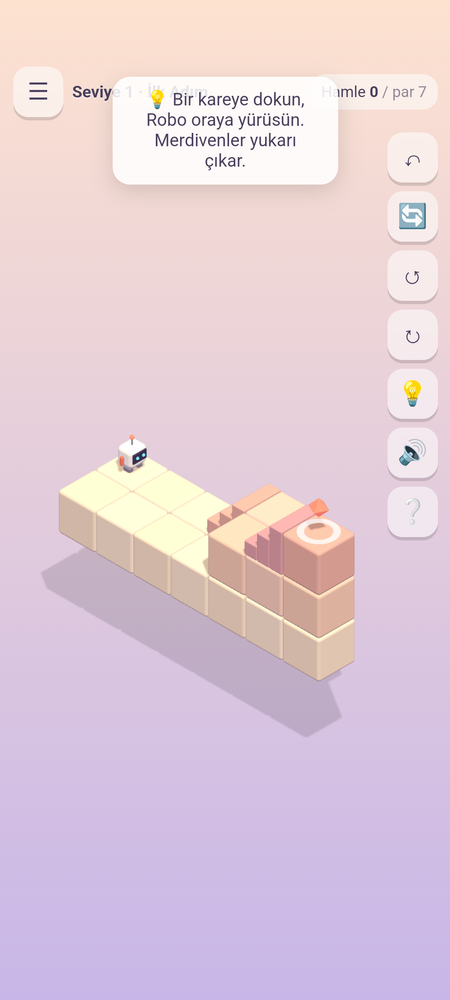
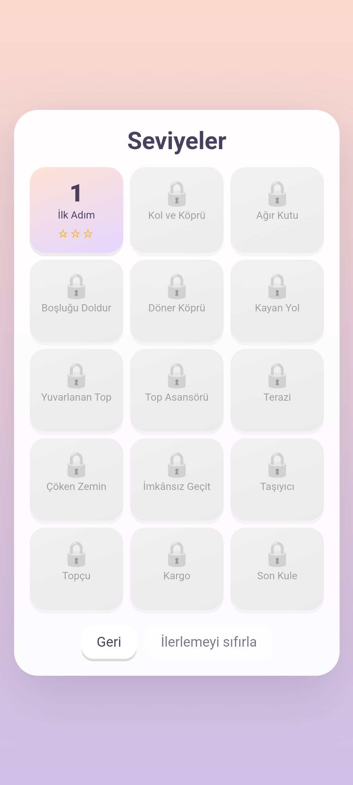
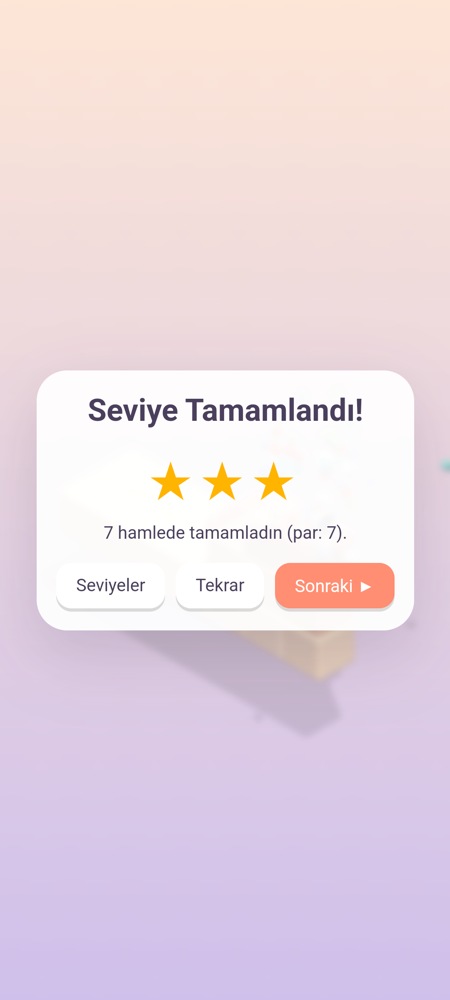

# Kayıp Kuleler — 3B Fizik Tabanlı Bulmaca Oyunu (Android)

[](../../actions/workflows/android.yml)
[](../../actions/workflows/tests.yml)

Mekorama ve Monument Valley'den esinlenen, izometrik pastel diorama görünümlü, beyin yoran bir 3B bulmaca oyunu.
Küçük robot **Robo**'yu dokunarak yönlendirir, mekanizmaları kullanarak her kulenin tepesindeki parlayan kristale ulaştırırsın.

<p align="center">
  
  
  
</p>

| Sürüm | Klasör | Teknoloji |
|---|---|---|
| **Android uygulaması (ana sürüm)** | `android/` | Kotlin, AndroidX WebView + `WebViewAssetLoader`; oyun `web/` klasöründen derleme sırasında kopyalanır |
| Tarayıcı | `web/` | Three.js r170 + cannon-es (yerel olarak paketlendi, CDN yok) |
| Godot | `godot/` | Godot 4.3, GDScript; Web / Linux / **Android** dışa aktarımı |

Her sürüm **aynı seviye dosyasını** (`levels.json`) ve **aynı kuralları** kullanır. 15 el yapımı seviye vardır; zorluk giderek artar.

---

## 1. Android

### APK'yı indirip kurma
* **Her push'tan sonra:** GitHub → **Actions** → *Android APK (Three.js + WebView)* → son çalıştırma → **Artifacts** → `KayipKuleler-apk-<sürüm>` (zip içinde iki APK). Godot sürümü için *Android APK (Godot sürümü)* → `KayipKuleler-godot-apk`.
* **Sürümler:** `v1.0.0` gibi bir etiket gönderildiğinde APK'lar otomatik olarak **Releases** sayfasına eklenir:
  ```bash
  git tag v1.0.0 && git push origin v1.0.0
  ```
* Telefonda APK'yı açın ("bilinmeyen kaynaklardan yükleme" izni istenir). Android 7.0 (API 24) ve üzeri desteklenir.

| Dosya | Açıklama |
|---|---|
| `KayipKuleler-<sürüm>.apk` | Release derlemesi (küçültülmüş, `com.akin.kayipkuleler`) |
| `KayipKuleler-<sürüm>-debug.apk` | Debug derlemesi (`com.akin.kayipkuleler.debug`, release ile yan yana kurulabilir) |
| `KayipKuleler-godot.apk` / `KayipKuleler-godot-debug.apk` | Godot motoruyla derlenen alternatif sürüm (`godot-android.yml`, `com.akin.kayipkuleler.godot`) |

> Release APK, kurulabilir olması için **debug anahtarıyla** imzalanır. Google Play'e yüklemek için kendi
> anahtarınızı oluşturup `android/app/build.gradle.kts` içindeki `signingConfigs` bölümüne (GitHub Secrets ile) bağlayın.

### Uygulamanın özellikleri
* Tam ekran (immersive) — sistem çubukları kenardan kaydırınca geçici olarak görünür; çentik alanı kullanılır.
* Dikey **ve** yatay yönlendirme (yatayda yan menü sağ altta yatay bir sıraya dönüşür).
* Oynarken ekran kapanmaz.
* **Geri tuşu:** ipucu → seviye ekranı → seviye seçimi → başlık → uygulamadan çıkış.
* İlerleme (`localStorage`) uygulama kapatılsa da korunur.
* İnternet izni yok; tüm dosyalar APK içinde, `https://appassets.androidplatform.net/assets/web/` adresinden güvenli şekilde sunulur.
* Dokunmatik: **dokun** = yürü / it / kolu çevir, **sürükle** = platform döndür/kaydır ya da kamera, **iki parmak** = yakınlaştır.

### Yerel derleme
Gereken: JDK 17 ve Android SDK (platform 35). `ANDROID_HOME` ayarlı değilse `android/local.properties` içine `sdk.dir=/yol/android-sdk` yazın.
```bash
cd android
./gradlew assembleDebug      # app/build/outputs/apk/debug/app-debug.apk
./gradlew assembleRelease    # app/build/outputs/apk/release/app-release.apk
./gradlew installDebug       # bağlı cihaza / emülatöre kurar
```
`web/` tek doğruluk kaynağıdır: Gradle'daki `copyWebGame` görevi her derlemede `web/` klasörünü APK varlıklarına kopyalar —
oyunda yapılan her değişiklik bir sonraki derlemede uygulamaya girer, kopya dosya tutmaya gerek yoktur.

Uygulama simgesi (pastel izometrik küp, Robo ve kristal; uyarlanabilir + tek renkli) `python3 tools/make_icons.py` ile yeniden üretilir.

### GitHub Actions iş akışları
| Dosya | Ne zaman | Ne üretir |
|---|---|---|
| `.github/workflows/android.yml` | `main`'e push, PR, `v*` etiketi, elle | Debug + release APK (artifact); etikette GitHub Release |
| `.github/workflows/tests.yml` | `main`'e push, PR, elle | Çözücü (15/15), headless Chrome oyun testi, Godot mantık + sahne testleri |
| `.github/workflows/godot-android.yml` | `godot/` değişince, `v*` etiketi, elle | Godot ile dışa aktarılmış Android APK'ları (artifact / Release) |

Sürüm kodu `GITHUB_RUN_NUMBER`, sürüm adı etiketten (`v1.2.0` → `1.2.0`) ya da `1.0.<çalıştırma no>` olarak otomatik verilir.

---

## 2. Diğer sürümleri çalıştırma

### Tarayıcı sürümü (Three.js)
ES modülleri kullandığı için dosyayı çift tıklayarak değil, basit bir yerel sunucu ile açın:

```bash
cd web
python3 -m http.server 8765
# tarayıcıda: http://localhost:8765
```
İnternet bağlantısı gerekmez — three.js, RoundedBoxGeometry ve cannon-es `web/vendor/` içindedir.
Doğrudan bir seviyeyi açmak için: `http://localhost:8765/?level=9`

### Godot sürümü
* **Editörde:** Godot 4.3 (veya daha yeni 4.x) ile `godot/project.godot` dosyasını açıp F5'e basın.
* **Android APK (Godot):** Godot 4.3 + Android dışa aktarım şablonları + Android SDK ile
  ```bash
  GODOT=/yol/godot ANDROID_HOME=/yol/android-sdk JAVA_HOME=/yol/jdk17 \
    tools/godot-android-export.sh godot-build/KayipKuleler-godot.apk debug
  ```
  (Betik gerekirse bir debug anahtarı oluşturur ve Godot editör ayarlarını yazar.) Godot sürümü telefonda yatay açılır.
* **Web / Linux dışa aktarımı:** bkz. bölüm 7.

---

## 3. Kontroller

| Eylem | Android / Tarayıcı | Godot |
|---|---|---|
| Robo'yu bir kareye yürüt | Kareye dokun / tıkla (otomatik yol bulma) | Sol tık |
| Kutuyu it / topa vur | Kutuya veya topa tıkla (Robo yanına gider ve iter) | Sol tık |
| Kolu çevir | Kola tıkla | Sol tık |
| Döner platformu çevir | Platformu yatay **sürükle**, çarkına tıkla ya da alttaki ↺ ↻ düğmeleri | Aynı (Sol / Sağ düğmeleri) |
| Kaydırıcıyı / asansörü hareket ettir | Platformu ray yönünde **sürükle**, ok konilerine tıkla ya da alttaki düğmeler | Aynı |
| Tek adım | Ok tuşları / WASD (kameraya göre) | Aynı |
| Kamerayı 90° çevir | Q / E, ↺ ↻ düğmeleri ya da boş alanda / sağ tıkla sürükle | Q / E, sağ tık sürükle |
| Yakınlaştır | İki parmakla kıstır / fare tekerleği | Fare tekerleği |
| Geri al / Yeniden başla | Z / R | Z / R |
| İpucu / Seviyeler / Kontroller | H / M / ? | H / M |

Hamle sayacı ve **par** (çözücünün bulduğu en kısa çözüm) üstte görünür. Par veya altında bitirirsen 3 yıldız alırsın.
İlerleme (açılan seviyeler, en iyi skorlar) Android uygulaması ve tarayıcıda `localStorage`, Godot'ta `user://ilerleme.json` içinde saklanır.

---

## 4. Mekanikler

| Mekanik | Açıklama | İlk göründüğü seviye |
|---|---|---|
| Merdiven | Bir kat yukarı / aşağı çıkar | 1 |
| Kol | Yanına gidip ona doğru yürüyünce açılır/kapanır, kalıcıdır | 2 |
| Basınç plakası | Üzerinde ağırlık (Robo, kutu, top) olduğu sürece sinyal verir | 3 |
| Beliren köprü / kapı | Sinyal doğruyken köprü katılaşır; kapılar sinyal ile açılır | 2, 5 |
| İtilebilir kutu | Yerçekimiyle düşer, boşlukları doldurup zemin olur, plakaları basılı tutar | 3, 4 |
| Döner platform | 90° döner; üzerindeki her şeyi (Robo, kutu) birlikte taşır | 5 |
| Kaydırıcı / asansör | Raylı platform; elle ya da bir sinyalle hareket eder, yükünü taşır | 6, 8 |
| Yuvarlanan top | Vurulunca bir engele çarpana dek yuvarlanır, boşluklara düşer, çarptığı kolu çevirir | 7 |
| Terazi (ağırlık) | Bağlı iki kefe: ağır olan iner, hafif olan çıkar | 9 |
| Çöken zemin | Robo üzerinden geçince parçalanıp düşer (rota planlaması) | 10 |
| Göz yanılması geçidi | Yalnızca belirli kamera açısından görsel olarak birleşen iki yol (Monument Valley tarzı) | 11 |

**Fizik hakkında not:** Bulmaca kuralları (yerçekimi, düşen kutular, yuvarlanma momentumu, ağırlık, taşıma) **deterministik bir ızgara fizik motorunda** çalışır (`web/js/engine.js` ve `godot/scripts/logic.gd`, birebir aynı kurallar). Mekorama'nın da yaptığı gibi bu seçim, her seviyenin kesin olarak çözülebilir olduğunu otomatik doğrulamayı mümkün kılar. Gerçek rijit-cisim fiziği ise görsel efektler için kullanılır: tarayıcıda **cannon-es**, Godot'ta **RigidBody3D** (çöken taşların parçaları, zafer konfetisi; parçalar dioramadaki bloklara çarpıp seker).

---

## 5. Seviyeler

| # | Ad | Mekanikler | Par |
|---|---|---|---|
| 1 | İlk Adım | merdiven, tıkla-yürü | 7 |
| 2 | Kol ve Köprü | kol, köprü | 13 |
| 3 | Ağır Kutu | kutu, basınç plakası | 19 |
| 4 | Boşluğu Doldur | kutularla boşluk doldurma | 19 |
| 5 | Döner Köprü | döner platform, kol, kapı | 16 |
| 6 | Kayan Yol | yatay kaydırıcı, asansör, kutu | 12 |
| 7 | Yuvarlanan Top | top, düşme, kol | 7 |
| 8 | Top Asansörü | top + plaka ile çalışan asansör | 20 |
| 9 | Terazi | ağırlık terazisi, iki kutu, merdiven | 16 |
| 10 | Çöken Zemin | çöken taşlar, üç kol | 17 |
| 11 | İmkânsız Geçit | göz yanılması, kamera açısı | 8 |
| 12 | Taşıyıcı | döner platformla kutu taşıma, kapı | 9 |
| 13 | Topçu | top, raylı durdurucu, kol + plaka | 18 |
| 14 | Kargo | kaydırıcıyla kutu taşıma, çöken taşlar | 17 |
| 15 | Son Kule | kol, kutu, döner platform, göz yanılması | 20 |

Her seviyenin adım adım çözümü `SOLUTIONS.md` dosyasındadır.

---

## 6. Yeni seviye ekleme

1. `tools/levels.src.mjs` dosyasına yeni bir nesne ekleyin. Koordinatlar `[x, y, z]`, **y yukarıdır**; Robo bir bloğun *üstündeki* hücrede durur (zemin y=0 ise Robo y=1'dedir).

```js
{
  name: 'Yeni Seviye', palette: 3, hint: 'İpucu metni',
  boxes:   [[0,0,0, 4,0,2]],            // [x1,y1,z1, x2,y2,z2] dolu kutu
  blocks:  [[5,1,1]],                   // tek bloklar
  remove:  [[2,0,1]],                   // kutulardan çıkarılacak hücreler
  stairs:  [{p:[3,1,0], d:0}],          // d: 0=+x 1=+z 2=-x 3=-z (yükselme yönü)
  crates:  [[1,1,1]],  balls: [[2,1,2]],
  plates:  [{id:'P1', p:[4,1,2]}],
  levers:  [{id:'L1', p:[0,1,2], on:false}],
  bridges: [{cells:[[5,0,1]], on:'P1'},            // sinyal doğruyken katı
            {cells:[[4,1,0]], on:'!L1', door:true}],// '!' ile ters -> kapı
  rotators:[{pivot:[x,z], blocks:[[..]], rot:0, handle:[x,y,z]}],
  sliders: [{blocks:[[..]], axis:[1,0,0], min:0, max:3, pos:0},          // elle
            {blocks:[[..]], axis:[0,1,0], min:0, max:2, pos:0, on:'P1'}],// asansör
  scales:  [{a:0, b:1}],                // iki kaydırıcıyı terazi yapar
  crumbles:[[2,0,0]],
  links:   [{a:[2,1,0], b:[5,3,2], d:0, view:0}], // göz yanılması (b = a + yön + k·(görüş vektörü))
  view: 0, start: [0,1,0], goal: [4,1,0],
}
```
`on` alanı bir dizi de olabilir (`['L1','P1']` = hepsi doğru olmalı).

2. Derleyin ve doğrulayın:
```bash
cd tools
npm install        # yalnızca ilk sefer (three, cannon-es, playwright-core)
node build.mjs     # her seviyeyi BFS çözücüyle çözer, par hesaplar,
                   # web/levels.json, web/js/levels.js, godot/data/levels.json ve SOLUTIONS.md yazar
```
Çözülemeyen bir seviye varsa `build.mjs` hata verir. Tek bir seviyenin çözümünü durum durum görmek için: `node show.mjs 9`.

---

## 7. Otomatik testler (yapılan doğrulamalar)

```bash
cd tools
node build.mjs                 # 15/15 seviye çözücüyle çözülebilir
node test.mjs                  # Headless Chrome: sayfa yüklenir, konsol hatası = 0,
                               # 15 seviyenin çözümü gerçek oyun eylem hattından oynatılır,
                               # Seviye 1 gerçek fare tıklamasıyla bitirilir, ekran görüntüleri alınır
G=/path/to/godot
$G --headless --path godot --script res://tests/run_solutions.gd   # GDScript motoru: 15/15
$G --headless --path godot -- --autotest                           # tam Godot sahnesi: 15/15
$G --headless --path godot --export-release "Web"   ../godot-build/web/index.html
$G --headless --path godot --export-release "Linux" ../godot-build/linux/KayipKuleler.x86_64
cd android && ./gradlew assembleDebug assembleRelease                # Android APK'ları
```
Android uygulaması ayrıca bir Android 14 emülatöründe denendi: başlık, seviye seçimi, dokunarak yürüme ile
Seviye 1'in bitirilmesi, iki parmakla yakınlaştırma, sürükleyerek platform döndürme, yatay düzen, geri tuşu
ve uygulama yeniden başlatıldığında ilerlemenin korunması.

---

## 8. Klasör yapısı

```
android/        Gradle (Kotlin DSL) projesi: app/src/main/{AndroidManifest.xml, java/.../MainActivity.kt, res/}
web/            index.html, style.css, js/{engine,main,audio,fx,levels}.js, levels.json, vendor/
godot/          project.godot, scenes/main.tscn, scripts/{logic,main}.gd, data/levels.json,
                tests/run_solutions.gd, export_presets.cfg (Web, Linux, Android)
tools/          levels.src.mjs (seviye kaynağı), build.mjs, show.mjs, test.mjs, shot.mjs,
                make_icons.py (uygulama simgesi), godot-android-export.sh
.github/workflows/  android.yml, tests.yml, godot-android.yml
screenshots/    oynanış ekran görüntüleri
SOLUTIONS.md    tüm seviyelerin çözümleri
```

## 9. Bilinen sınırlamalar
* Release APK debug anahtarıyla imzalıdır (yan yükleme için yeterli; Play Store için kendi anahtarınız gerekir).
* Android uygulaması sistem WebView'ini (WebGL 2) kullanır; çok eski / güncellenmemiş WebView'li cihazlarda performans düşük olabilir.
* Godot sürümü aynı oyun mantığına ve seviyelere sahiptir ancak görselleri daha sadedir (yuvarlatılmış blok kenarları yok, ses yok).
* Godot Android APK'sı ~70 MB'tır (motor dahil). Android emülatörünün yazılımsal GPU'sunda (SwiftShader, GLES 3.0)
  Godot'un sahne shader'ı uniform sınırını aştığı için 3B sahne çizilmiyor (arayüz çalışıyor); gerçek cihaz GPU'larında
  bu sınır daha yüksektir, ancak gerçek cihazda denenmedi.
* `godot-android.yml` ilk çalıştırmada Godot dışa aktarım şablonlarını (~1 GB) indirir; sonraki çalıştırmalarda önbellekten gelir.
* Testler yazılımsal GPU'lar (Chrome SwiftShader, Mesa llvmpipe, Android emülatörü) üzerinde yapıldı; fiziksel telefonda denenmedi.
